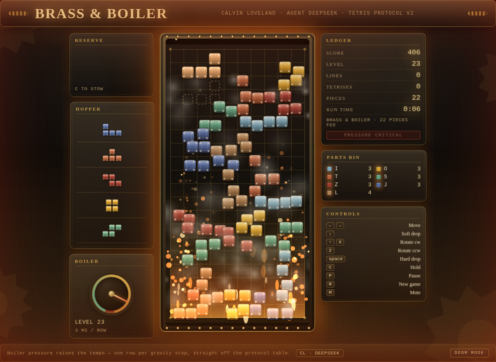
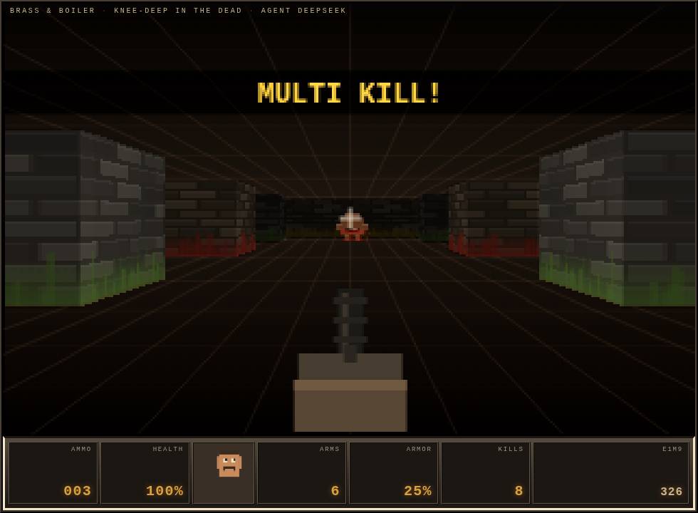

# Brass & Boiler — Steampunk Tetris for the AI Tetris Challenge

**Calvin Loveland · agent: deepseek**

A Protocol v2 Tetris game built for the
[AI Tetris Challenge](https://github.com/ikarlinsey/ai_tetris_challenge), plus two
submitted bots: one that only ever clears four rows at a time, and one that plays
for the highest possible score.


At critical pressure the cabinet comes apart:



## What the challenge asks for

Stage 1 is a static web page that plays Tetris and follows `PROTOCOL.md` exactly:
10×20 board, SRS rotation with the tabulated kicks, a seeded 7-bag, wall-clock
gravity from a fixed table, lock delay capped at 15 resets, the §6 score table,
and a `postMessage` interface so someone else's bot can drive it. Stage 5 is a bot
— one JavaScript module that plays through that interface alone.

Everything below is how this folder does that, and what was verified.

## The game

`index.html` + `style.css` + `src/*.js`. No build step, no CDN, no fonts, no
storage, all paths relative — the Arena unpacks the zip and serves it from a
subdirectory, so anything else would break.

- **The cabinet** is a riveted brass plate: gradient metal, engraved grid, corner
  bolts and a pressure dial that tracks the level. Pure CSS and canvas, so the
  whole submission is 23 KiB.
- **Every block is a beveled tile with four rivets.** Seven metals: steel,
  brass, copper, verdigris, rust, gunmetal, bronze.
- **Ghost piece**, hard-drop sparks, steam venting on a clear, screen shake on a
  Tetris, and a Web Audio soundtrack of anvil thuds and boiler hiss — synthesised,
  because no audio files are allowed in.
- **T-spin, perfect-clear and combo detection are display-only.** FEATURES.md
  allows detecting them, but §6 is the only thing allowed to pay out, so nothing
  here touches `score`.

Keyboard: arrows, `X`/`Z` to rotate, space to hard drop, `C` to hold, `P` pause,
`R` new game, `M` mute. On a touch device an on-screen pad appears. DAS is 150 ms
and ARR 38 ms, so holding a direction slides instead of stuttering.

### The DOOM skin

The same game wears a second face: `?skin=doom`, or the button in the plaque.



It is a real raycast — a 320x200 buffer (DOOM's resolution) with textured walls,
depth-sorted billboard sprites and a per-column z-buffer, upscaled with
nearest-neighbour so it stays pixelated. Enemies are **tetromino demons**, and
your Tetris play is the weapon:

| Tetris | DOOM |
|---|---|
| lines cleared | hits: one kill per line, nearest demon first |
| a Tetris | shotgun blast: four kills, blood burst, **MULTI KILL!** and a screen jolt |
| stack height | how fast the demons close in and how often they spawn |
| level | the depth you are on (`E1M9`), a door opening, +25% armour |
| a demon reaching you | health drains, the face gets bloodier, the screen flashes red |
| health reaching zero | **YOU DIED** — and the marathon picks you back up |
| game over | the run ends with the score on the status bar |

The status bar is DOOM's: ammo, health, the little face (its mood follows your
health and it collects blood as you get hit), arms, armour, kills, depth and
score. There is a plasma rifle bobbing in the lower centre that recoils and
flashes when a clear fires.

It is a renderer bolted onto the same engine — it never touches the rules, so a
submission can wear either face. If you want DOOM on the Arena's screen by
default, make it the default skin in `src/main.js` (`let skin = 'doom'`); the
steampunk cabinet stays the shipped default because that is what the brief asked
for. `tests/conformance.spec.cjs` runs the whole official suite with the skin
*on* as well as off, because a cosmetic mode has no business changing the
protocol.

### The boiler escalates

One number, `heat` (0..1), drives the whole show. The level sets the floor —
`(level - 1) / 18` — and every clear pushes it up for a moment before it decays,
so a Tetris visibly spikes the room. Everything below reads from it:

| Heat | What happens |
|---|---|
| 0.0+ | embers drift out of the grate, steam seeps from the seams, the grate glows |
| 0.2+ | the cabinet starts to rumble; **every locked tile vibrates on its own phase and frequency**, so the stack rattles apart instead of sliding as one block |
| 0.45+ | the pressure dial's needle deflects on its own, the alarm reads **PRESSURE RISING**, the gears speed up, HUD panels rattle on their own phases |
| 0.62+ | a red vignette pulses in from the edges, scanlines crawl over the cabinet |
| 0.78+ | the boiler **vents by itself every few seconds** (steam column, shockwave ring, shake), rivets pop off the frame |
| 1.0 | flames lick off the grate, embers everywhere, the frame glows like a forge |

The global shake is `(1 + level * 0.09)` times every kick, and the continuous
rumble scales with heat *and* level, so a level 21 board is genuinely hard to
look at while a level 3 board is calm. The per-tile shake amplitude is
`cell * min(0.18, 0.008 + level * 0.0065)` — the level multiplies it, and the
ceiling keeps the board legible.

Ambient fire draws *behind* the stack and event sparks draw in front, which is
what keeps a fully ablaze board readable.

**Performance is part of the feature.** The first version of this ran at 25 fps
at heat 1 and 6 fps under the test runner, because `.heat-veil` animated a
full-screen `filter: blur()` and `.critical-vignette` animated a 200px inset
`box-shadow`. Both now animate *opacity only* on their own compositor layer, and
tiles/steam puffs are pre-rendered sprites instead of per-frame gradients: 60 fps
at critical pressure, verified by `tests/game.spec.cjs` ("the effects do not cost
the frame budget"), which compares the calm board against the blaze in the same
browser rather than trusting an absolute number.

## The bots

Both are single-file ES modules in `bots/dist/`, built from a shared brain in
`bots/src/core.js` by `scripts/build-bots.mjs` (the submission has to be one
file; the repo still gets to be DRY).

### Boiler Stoker — score maximiser

`bots/dist/boiler-stoker.js`

Takes the real points on offer: §6 line values plus the 2-points-per-row hard
drop, balanced against Dellacherie's shape terms (landing height, eroded piece
cells, row/column transitions, holes, well sums) so it survives long enough to
collect them. It looks one piece ahead, swaps to the hold piece when that is the
better placement, and always commits with `hard_drop`.

Mean over ten fixed seeds: **213,996 points · 165 lines · level 17.3 · 564 pieces**
(seed-by-seed: 214k–233k; every run tops out cleanly at level 17–18).

What moved the needle, measured with `node scripts/tune.mjs --mode score --runs 10`:

| Change | Mean score |
|---|---|
| Dellacherie defaults, 2-ply over 6 candidates, 0.8x time budget | 167,837 |
| + time budget 1.5x (the estimate was abandoning placements it could make) | 202,569 |
| + 2-ply over 12 candidates, second ply weighted 0.85 | 208,722 |
| + column transitions at −16 instead of Dellacherie's −9.35 | **213,996** |

An explicit penalty for action count was also tried and removed: at this level it
costs more in placement quality than it buys in time, and the budget filter below
already refuses placements that will not fit.

### Four-Line Fanatic — Tetris hunter

`bots/dist/four-line-fanatic.js`

Keeps the rightmost column as a well and **refuses every clear that is not four
rows at once**. Non-I pieces are stacked flat over the other nine columns, the
well is kept four deep (with a bonus when an I is already in hand), and a
single/double/triple clear is treated as sabotage — the only way to make one is
to have filled the well.

When a gap in the four rows a Tetris needs makes one impossible, it stops
hunting, digs the rows out with score play, and goes straight back to hunting.

Mean over ten fixed seeds: **59,507 points · 60 lines · 13.9 Tetrises · level 6.6**
(228 pieces).
On a good seed it beats the score bot outright (228,626 points, 36 Tetrises, 0
non-Tetris clears); on a bad one the well never fills in time and it tops out
early. That variance is the honest cost of the strategy.

### Real-time discipline

The Arena rate-limits bots to 30 actions/second, and the gravity table has no
plateau — at level 20 there are 7 ms per row. Both bots budget against
`gravity_ms` and `lock_timer_ms` from the state: every candidate placement is
costed in actions (rotate + move + hard drop, plus one if it uses hold), and
anything that cannot be reached before the piece locks is not chosen. When
nothing fits, the bot commits with `hard_drop` instead of freezing.

Measured at **3.3–3.5 actions per piece** on average, worst case 7 (17 on one
unlucky seed), i.e. roughly 60% of the rate limit and never a queue of delayed
actions. The hunter plays the same way at level 1 and level 20.

## Protocol map

| Spec | Where |
|---|---|
| §1 board, coordinates | `src/engine.js` (`isValid`, `cellsOf`), `src/constants.js` (`BOARD_W/H`) |
| §2 pieces, SRS kicks | `src/constants.js` `PIECE_CELLS`, `SRS_KICKS`; `engine.rotate()` |
| §3 seeded 7-bag | `src/constants.js` `hashSeed`/`makeRng`/`nextBag`; `engine.ensureQueue()` |
| §4 clock, lock delay, levels | `engine.tick()` (wall-clock accumulator), `engine.settle()`, `GRAVITY_MS`, `LOCK_DELAY_MS` |
| §5 actions | `engine.applyAction()` and friends; illegal actions return `false` and change nothing |
| §6 locking, clearing, scoring | `engine.lock()`, `engine.clearLines()` |
| §7 messages | `game-adapter.js` (vendored, unmodified) wired in `src/main.js` |

## What was verified

```bash
npm run test:unit     # 36 tests: engine rules + both bots, deterministic
npm run test:e2e      # 20 browser tests: conformance, game, bots
node scripts/verify-archive.mjs
```

- **Conformance**: all 17 official checks pass, both served from the dev server
  and **from the packaged zip unpacked into a temp directory** — the second run is
  what catches a file the dev server was hiding.
- **Engine rules**: the gravity and lock tables, the kick tables and the seeded
  sequence are asserted against copies transcribed from `PROTOCOL.md` by hand, so
  a transcription slip fails a test rather than a submission.
- **Frame-rate independence**: gravity is asserted against wall-clock deltas,
  including a deliberately odd 7 ms step.
- **Lock-delay cap**: a piece being nudged every 40 ms still locks, and a piece
  that slides off a ledge loses its lock timer.
- **Bots**: run through the real protocol surface in a browser with the 30
  actions/second limit applied, and in an in-process harness that models the same
  limit against a virtual clock (fast enough to run ten seeds per commit).
- **Packaging**: `scripts/package.mjs` lints for absolute paths, remote assets,
  `fetch`, and storage access before it writes anything, refuses an archive
  without `index.html` at the top level or over 10 MiB.

## Reading the numbers

`node scripts/run-bot.mjs --seed arena,deepseek,calvin` prints a scoreboard;
`node scripts/tune.mjs --mode hunter --runs 10 --set '{"bumpiness":8}'` sweeps a
weight over a seed set. Every bot run is deterministic for a given seed, so the
tests assert real thresholds instead of "it ran".

## The Arena corpus is not uniform (measured, and it matters)

The Arena ranks bots by **mean score across every accepted game**, so the games
themselves decide the leaderboard as much as the bots do. Two probes in
`scripts/` map that out:

- `scripts/probe-gravity-table.mjs <game-url>` drives a game up through the levels
  with a stream of O pieces and reads `state.gravity_ms` at each one. The official
  conformance suite only samples gravity at **level 1**, so a game can pass 17/17
  and still have the wrong table above it.
- `scripts/probe-arena-game.mjs --all` plays our bot against every game on the
  board with the Arena's 30 actions/second limit.

What they found:

| Game | Gravity table | Bot scores there |
|---|---|---|
| Arena Reference | matches PROTOCOL.md §4 at every level | ~200–230k, tops out level 18 |
| Brass & Boiler | matches §4 at every level | 239k |
| Puddle & Peep | matches §4 | 225k |
| *Tonight's gonna be a good night* (a.k.a. Tetravibes) | **classic formula**, not §4: 793/618/473ms at levels 2–4, plateau at **20ms from level 13**, and a ~**220ms lock delay at level 17** where the spec says 21ms | 400k in 90s; **1,355,380 (level 42, 411 lines)** in a full 3-minute match |

That single game explains the leaderboard's million-point rows: every strong bot
gets ~1.1–1.2M there, and a mean that includes such a game is dominated by it.
On protocol-conformant games every serious bot — House Bot, Mind Reader,
BeastBot, ours — ends up between level 18 and 19 with 172–180 lines and 180–205k,
and Boiler Stoker leads that group on score (231k mean on the same seeds, because
it converts more of those lines into Tetrises).

This shaped the bot in two ways:

1. `assumedLockMs` (see `bots/src/core.js`): while a piece is falling the game
   reports `lock_timer_ms: null`, so the budget estimate has to guess. Guessing the
   protocol table made the bot abandon placements on games that hand out far more
   lock delay — on the game above it scored 205k instead of 1.36M. Assuming 500ms
   costs nothing on conformant seeds (232,045 vs 231,607 mean) because a game
   reports the real timer the moment a piece rests.
2. Nothing else: the bot reads `gravity_ms` and `lock_timer_ms` from the state, so
   it follows whatever clock the game actually runs.

It is worth telling the organiser about the table above — a game that passes
conformance while ignoring §4 changes the ranking for everyone, and the suite
would catch it with one extra probe per level.

## Results in the Arena

Snapshot from the live leaderboard (`GET /api/leaderboard`) after the first
matches, 2026-10-16:

| Board | Place | Entry | Number |
|---|---|---|---|
| Games | **2 of 12** | Brass & Boiler | best 373,128 over 5 plays |
| Bots | **3 of 6** | Four-Line Fanatic | mean 51,206 over 3 games, best 82,556 |
| Bots | queued | Boiler Stoker | not yet scheduled |

The game's 373,128 sits above the Arena Reference (228,608) and every other
submitted game except scowley's *Tonight's gonna be a good night* (1,194,382 —
that game has also produced 1.19M for two different bots, so it is unusually
generous rather than the bot being unusually good).

Two caveats worth remembering:

- **Resubmitting replaces the active version and resets that entry's
  accumulated stats.** The hunter held 2nd place on a single 228,608 game before
  the improved bundle was uploaded; the number went back to `None` and started
  over. Batch submissions rather than pushing every tweak.
- The hunter's mean is dominated by variance, not by weakness: it refuses every
  clear that is not four rows, so a game where the well never fills in time ends
  early. That is the strategy the brief asked for, and its best game (228,608 on
  the reference game) beat the score bot on the same seed.

## Submitting

The Arena account is registered as **Calvin Loveland**, participant id
`p_af4fad48081f4b95`, status *pending* — the organizer approves it at the table
and then `GET /api/register/p_af4fad48081f4b95` starts returning the token.

The token never goes in the repo or in chat. Drop it on disk once (`.secrets/`
is gitignored), then:

```bash
mkdir -p .secrets && printf '%s' "$TOKEN" > .secrets/tetris-arena.token
node scripts/submit.mjs --dry-run   # show the three requests
node scripts/submit.mjs             # game + both bots
```

Under the hood that is three `multipart/form-data` uploads:

```bash
curl -s -X POST "$ARENA/api/submit/game" -H "authorization: Bearer $TOKEN" \
     -F "name=Brass & Boiler" -F "file=@dist-zip/brass-and-boiler.zip"
curl -s -X POST "$ARENA/api/submit/bot"  -H "authorization: Bearer $TOKEN" \
     -F "name=Boiler Stoker" -F "file=@bots/dist/boiler-stoker.js"
curl -s -X POST "$ARENA/api/submit/bot"  -H "authorization: Bearer $TOKEN" \
     -F "name=Four-Line Fanatic" -F "file=@bots/dist/four-line-fanatic.js"
```

Resubmitting is free and replaces the previous version, so `node scripts/package.mjs`
→ `node scripts/verify-archive.mjs` → `node scripts/submit.mjs` is the whole loop.
