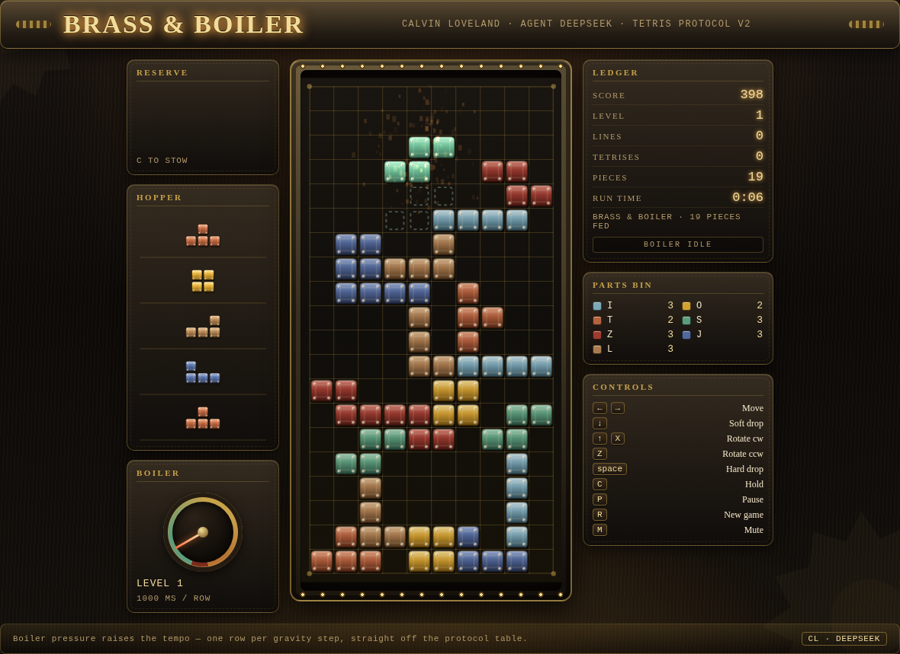

# Brass & Boiler — Steampunk Tetris for the AI Tetris Challenge

**Calvin Loveland · agent: deepseek**

A Protocol v2 Tetris game built for the
[AI Tetris Challenge](https://github.com/ikarlinsey/ai_tetris_challenge), plus two
submitted bots: one that only ever clears four rows at a time, and one that plays
for the highest possible score.



## What the challenge asks for

Stage 1 is a static web page that plays Tetris and follows `PROTOCOL.md` exactly:
10×20 board, SRS rotation with the tabulated kicks, a seeded 7-bag, wall-clock
gravity from a fixed table, lock delay capped at 15 resets, the §6 score table,
and a `postMessage` interface so someone else's bot can drive it. Stage 5 is a bot
— one JavaScript module that plays through that interface alone.

Everything below is how this folder does that, and what was verified.

## The game

`index.html` + `style.css` + `src/*.js`. No build step, no CDN, no fonts, no
storage, all paths relative — the Arena unpacks the zip and serves it from a
subdirectory, so anything else would break.

- **The cabinet** is a riveted brass plate: gradient metal, engraved grid, corner
  bolts and a pressure dial that tracks the level. Pure CSS and canvas, so the
  whole submission is 23 KiB.
- **Every block is a beveled tile with four rivets.** Seven metals: steel,
  brass, copper, verdigris, rust, gunmetal, bronze.
- **Ghost piece**, hard-drop sparks, steam venting on a clear, screen shake on a
  Tetris, and a Web Audio soundtrack of anvil thuds and boiler hiss — synthesised,
  because no audio files are allowed in.
- **T-spin, perfect-clear and combo detection are display-only.** FEATURES.md
  allows detecting them, but §6 is the only thing allowed to pay out, so nothing
  here touches `score`.

Keyboard: arrows, `X`/`Z` to rotate, space to hard drop, `C` to hold, `P` pause,
`R` new game, `M` mute. On a touch device an on-screen pad appears. DAS is 150 ms
and ARR 38 ms, so holding a direction slides instead of stuttering.

## The bots

Both are single-file ES modules in `bots/dist/`, built from a shared brain in
`bots/src/core.js` by `scripts/build-bots.mjs` (the submission has to be one
file; the repo still gets to be DRY).

### Boiler Stoker — score maximiser

`bots/dist/boiler-stoker.js`

Takes the real points on offer: §6 line values plus the 2-points-per-row hard
drop, balanced against Dellacherie's shape terms (landing height, eroded piece
cells, row/column transitions, holes, well sums) so it survives long enough to
collect them. It looks one piece ahead, swaps to the hold piece when that is the
better placement, and always commits with `hard_drop`.

Mean over ten seeds: **167,837 points · 145 lines · level 15.2 · 521 pieces**.

### Four-Line Fanatic — Tetris hunter

`bots/dist/four-line-fanatic.js`

Keeps the rightmost column as a well and **refuses every clear that is not four
rows at once**. Non-I pieces are stacked flat over the other nine columns, the
well is kept four deep (with a bonus when an I is already in hand), and a
single/double/triple clear is treated as sabotage — the only way to make one is
to have filled the well.

When a gap in the four rows a Tetris needs makes one impossible, it stops
hunting, digs the rows out with score play, and goes straight back to hunting.

Mean over ten seeds: **59,512 points · 60 lines · 13.9 Tetrises · level 6.6**.
On a good seed it beats the score bot outright (228,626 points, 36 Tetrises, 0
non-Tetris clears); on a bad one the well never fills in time and it tops out
early. That variance is the honest cost of the strategy.

### Real-time discipline

The Arena rate-limits bots to 30 actions/second, and the gravity table has no
plateau — at level 20 there are 7 ms per row. Both bots budget against
`gravity_ms` and `lock_timer_ms` from the state: every candidate placement is
costed in actions, and anything that cannot be reached before the piece locks is
not chosen. Measured at **3.3–3.4 actions per piece** on average, with a worst
case of 7 (17 on one unlucky seed), well inside the budget. The hunter plays the
same way at level 1 and level 20.

## Protocol map

| Spec | Where |
|---|---|
| §1 board, coordinates | `src/engine.js` (`isValid`, `cellsOf`), `src/constants.js` (`BOARD_W/H`) |
| §2 pieces, SRS kicks | `src/constants.js` `PIECE_CELLS`, `SRS_KICKS`; `engine.rotate()` |
| §3 seeded 7-bag | `src/constants.js` `hashSeed`/`makeRng`/`nextBag`; `engine.ensureQueue()` |
| §4 clock, lock delay, levels | `engine.tick()` (wall-clock accumulator), `engine.settle()`, `GRAVITY_MS`, `LOCK_DELAY_MS` |
| §5 actions | `engine.applyAction()` and friends; illegal actions return `false` and change nothing |
| §6 locking, clearing, scoring | `engine.lock()`, `engine.clearLines()` |
| §7 messages | `game-adapter.js` (vendored, unmodified) wired in `src/main.js` |

## What was verified

```bash
npm run test:unit     # 36 tests: engine rules + both bots, deterministic
npm run test:e2e      # 20 browser tests: conformance, game, bots
node scripts/verify-archive.mjs
```

- **Conformance**: all 17 official checks pass, both served from the dev server
  and **from the packaged zip unpacked into a temp directory** — the second run is
  what catches a file the dev server was hiding.
- **Engine rules**: the gravity and lock tables, the kick tables and the seeded
  sequence are asserted against copies transcribed from `PROTOCOL.md` by hand, so
  a transcription slip fails a test rather than a submission.
- **Frame-rate independence**: gravity is asserted against wall-clock deltas,
  including a deliberately odd 7 ms step.
- **Lock-delay cap**: a piece being nudged every 40 ms still locks, and a piece
  that slides off a ledge loses its lock timer.
- **Bots**: run through the real protocol surface in a browser with the 30
  actions/second limit applied, and in an in-process harness that models the same
  limit against a virtual clock (fast enough to run ten seeds per commit).
- **Packaging**: `scripts/package.mjs` lints for absolute paths, remote assets,
  `fetch`, and storage access before it writes anything, refuses an archive
  without `index.html` at the top level or over 10 MiB.

## Reading the numbers

`node scripts/run-bot.mjs --seed arena,deepseek,calvin` prints a scoreboard;
`node scripts/tune.mjs --mode hunter --runs 10 --set '{"bumpiness":8}'` sweeps a
weight over a seed set. Every bot run is deterministic for a given seed, so the
tests assert real thresholds instead of "it ran".

## Submitting

The Arena account is registered as **Calvin Loveland**, participant id
`p_af4fad48081f4b95`, status *pending* — the organizer approves it at the table
and then `GET /api/register/p_af4fad48081f4b95` starts returning the token.

The token never goes in the repo or in chat. Drop it on disk once (`.secrets/`
is gitignored), then:

```bash
mkdir -p .secrets && printf '%s' "$TOKEN" > .secrets/tetris-arena.token
node scripts/submit.mjs --dry-run   # show the three requests
node scripts/submit.mjs             # game + both bots
```

Under the hood that is three `multipart/form-data` uploads:

```bash
curl -s -X POST "$ARENA/api/submit/game" -H "authorization: Bearer $TOKEN" \
     -F "name=Brass & Boiler" -F "file=@dist-zip/brass-and-boiler.zip"
curl -s -X POST "$ARENA/api/submit/bot"  -H "authorization: Bearer $TOKEN" \
     -F "name=Boiler Stoker" -F "file=@bots/dist/boiler-stoker.js"
curl -s -X POST "$ARENA/api/submit/bot"  -H "authorization: Bearer $TOKEN" \
     -F "name=Four-Line Fanatic" -F "file=@bots/dist/four-line-fanatic.js"
```

Resubmitting is free and replaces the previous version, so `node scripts/package.mjs`
→ `node scripts/verify-archive.mjs` → `node scripts/submit.mjs` is the whole loop.
