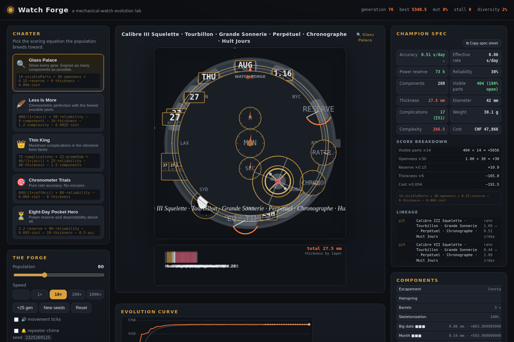

# Watch Forge — Evolve the Perfect Mechanical Watch

An evolutionary mechanical-watch simulator. Breed a population of watch
chromosomes against a **charter** (scoring equation), watch the champion
evolve on a live animated skeletonized dial, then save it to the Hall of Fame.



## Charters (`evolution.js`)

Five objectives, each a transparent equation over the champion phenotype
(see the in-app “Score breakdown” panel for live term-by-term values):

1. **Glass Palace** (skeleton) — `14·visibleParts + 30·openness + 0.15·reserve − 6·thickness − 0.004·cost`
2. **Less Is More** (minimalist) — `480/(1+|acc|) + 50·reliability − 9·components − 14·thickness − 1.2·complexity − 0.0025·cost`
3. **Thin King** (grand complication) — `75·complications + 22·gradeSum + 40/(1+|acc|) + 25·reliability − 48·thickness − 1.5·components`
4. **Chronometer Trials** — `600/(1+|effAcc|) + 80·reliability − 0.004·cost − 8·thickness`
5. **Eight-Day Pocket Hero** — `2.2·reserve + 90·reliability − 0.003·cost − 10·thickness − 0.5·acc`

The behavioural intent of every equation is locked by
`tests/fitness.test.mjs` (e.g. "skeletonizing an identical build scores
higher", "three grades of the same complication beat one for Thin King").
Rebalance with intent; the tests will hold you honest.

## Domain model (`data.js`, `watch.js`)

A chromosome = base genes + per-complication grade:

- **Escapements**: Swiss lever → co-axial → detent chronometer → constant
  force (each multiplies the base 3.0 s/day deviation down; `accFactor` is
  multiplicative so upgrades can't overshoot)
- **Balances**: plain → screw → free-sprung → mono-metallic
- **Hairsprings**: steel → Glucydur BeCu → silicon
- **Beat rates**: 18,000 / 21,600 / 28,800 / 36,000 vph (higher = better rate,
  more draw, more wear)
- **Barrels**: 1–3 (@ 44 h nominal reserve each), **train wheels**: 3–9,
  **skeletonization**: 0–100%, **diameter**: 28–42 mm
- **17 complications**, grades 1–3 (grade refines cost/complexity/visibility,
  never adds parts): date, big date, day, month, leap year, perpetual
  calendar, moon phase, equation of time, GMT, world timer, chronograph,
  rattrapante, power reserve, regulator, jumping hour, tourbillon, minute
  repeater

Phenotypes are deterministic (noise seeded from the genotype hash) so GA
fitness comparisons are stable. Derived stats: componentCount,
visibleComponents, thickness, weight, cost, complexity, powerReserve,
accuracy, effectiveAccuracy (= accuracy × (2 − reliability)), reliability.

## Genetic algorithm (`evolution.js`)

- Fitness = charter score; elites survive
- Uniform-blend crossover with grade-biased complication inheritance
- Per-gene mutation; **adaptive mutation** — when best fitness stalls, the
  mutation rate climbs (capped at 35%) so the search can jump local maxima
- **Themed founding cohorts** — each charter seeds its population with a
  pristine archetype (Glass Palace opens with an openworked 15+ complication
  monster, Minimalist opens with a bare silicon precision engine,
  Thin King opens complication-loaded on a slim base…) plus m,ated drift
- `diversity(population)` reports the fraction of distinct complication
  signatures — when it collapses, hit “New seeds”
- `evolvePopulation` returns `{ population, scored, best, stall, mutRate,
  lastBest }` — pass `lastBest`/`stall` back in for continuity

## Rendering (`render.js`)

- **Dial**: skeletonized plate built on an offscreen canvas with alpha-punched
  apertures (aperture size ∝ openness); animated barrels, meshing gear train
  (ratio chain 1:5), stepped escape wheel, oscillating balance + hairspring,
  rotating tourbillon cage, repeater gongs with hammer taps, GMT/world-time
  rings, calendar windows, moon phase… every complication has a slot and a
  drawing routine in `COMPLICATION_SLOTS`
- **Side profile**: stacked thickness layers with per-layer mm
- **Fitness chart**: best (orange) + average (grey) curve with automatic
  decimation when the series grows

## UI (`game.js`, `index.html`)

Three columns: charter + forge controls + Hall of Fame · live dial +
profile + curve · champion spec + score breakdown + component list +
watchmaker bench. Evolution steps on a per-frame **time budget** so 1000×
stays interactive. `window.WATCH_FORGE` is the Playwright test surface.

## Testing

```
npm test          # 28 node:test units: phenotype, fitness intents, GA behaviour
npm run test:e2e  # 8 Playwright checks: boot, no-errors, evolution, charter
                  # switching, watchmaker, HOF, canvas pixel probes
npm run check     # node --check all sources
```

On NixOS, Playwright uses Nix-managed Chrome
(`/run/current-system/sw/bin/google-chrome`, override `CHROMIUM_PATH`);
`.npmrc` disables Playwright's own (non-runnable) browser download.

## Making changes

1. Change domain rules in `data.js` / `watch.js` (keep phenotype deterministic).
2. Re-tune charters in `evolution.js` — update the equation strings AND the
   behavioural tests in `tests/fitness.test.mjs`.
3. Render new components in `render.js` via `COMPLICATION_SLOTS`.
4. `npm test` + `npm run test:e2e` before committing.