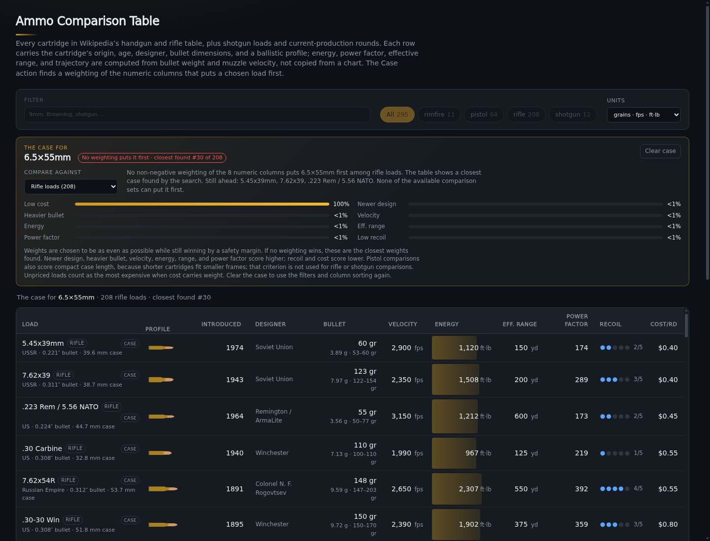
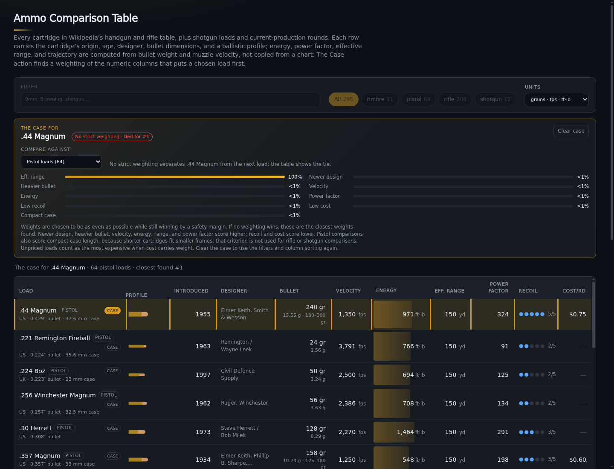

# Review — “Make the case” (ammo-compare)

**Reviewed:** `origin/main` @ `813c034f`, the case-maker work synced from the 1337book host
(`c898461a` export script → `cf9a78f9` feature → `4c2fde69`, `813c034f` follow-ups).

> **Branch note.** This file lives on the local branch, which does *not* contain that code.
> Local `main` and `origin/main` diverged after `e68586b9`: local main took the
> `data/cartridges.js` + `lib/schema.js` / `lib/relationships.js` rewrite (214 cartridges),
> origin/main kept `data/ammo.js` and added silhouettes, trajectory, designers, and this
> Case feature (295 loads). Nothing here was merged; the review is written against
> `origin/main` so it is ready when the two lines are reconciled.

## Verdict

The feature is well built: the math is precomputed offline, the browser only re-evaluates
stored weights, generator/browser parity is enforced by a test, and the documentation is
better than most. Every claim I could check in the docs is numerically correct.

The weak point is the **fallback path**: 191 of the 295 loads get it as their default view, and
it is presented in a way that contradicts the feature's own copy and the design doc. Two of
the cases I captured read as a bug. Details in P1 below.

## What I verified

| Check | Result |
|---|---|
| `node --test tests/*.test.mjs` | 49/49 pass |
| `tests/interaction.check.mjs` against Chromium 148 headless | 79/79 pass |
| `python3 tools/build-cases.py` regeneration | byte-identical to the checked-in `data/cases.js`; **11 m 30 s** |
| Docs counts (295 loads, 284/11/64/208/12 per scope, 874 load/scope results, 104 auto-feasible, 68 priced / 227 unpriced, 270 designers) | all exact |
| Stored ranks reproduced with the browser percentile math | 874/874, 0 mismatches |
| “No weighting can win” verdicts re-derived with the max-margin LP (32 sampled) | max margin ≤ 0 in every case (9mm/all −0.00102, .380/all −0.02521, .380/centerfire −0.01520, `22-hornet`/rifle exactly 0) |
| Fallback rank quality (16 sampled one-hot cases × 6 000 random Dirichlet weightings) | stored rank never beaten — the search is not leaving ranks on the table |

So: the numbers are sound, the artifact is reproducible, and the fallback is not
under-optimizing. The defects are in presentation and integration.

## P1 — the fallback shows a 100 % single-column weighting

659 of the 874 load/scope results are infeasible. **172 of them (26 %) come back as a
one-hot weight vector**, and 76 of the 191 auto-selected cases (40 %) are one-hot. The
column that carries the weight is almost always cost (92) or recoil (65), because the
max-margin LP's optimum is a simplex vertex.

Two user-visible consequences:

1. **`6.5×55mm`** → `closest found #30 of 208`, weights `Low cost 100 %`, margin −0.5676.
   The table becomes a price sort (5.45×39, 7.62×39, .223, .30 Carbine…); the selected load
   is not on screen. The panel note says “No non-negative weighting … puts 6.5×55mm first”
   while displaying a weighting that is 100 % one column.

   
2. The panel footer in the same box still reads “Weights are chosen to be as even as
   possible…”, which is only true for the feasible branch (`tools/build-cases.py` step 2).
   For the fallback the doc says “closest weights found”, but nothing tells the reader that
   the result is a corner of the simplex.

Not a math bug — I could not find a better rank for any sampled case — but as a feature it
does not do what it says for 40 % of loads.

**Suggested fix (pick one):**

- Keep the table untouched when `feasible === false`; show the weights, the rank, and the
  rows still ahead in the panel only. This matches the doc's own framing (“the panel shows …
  the rows still ahead when the case loses”).
- Or keep the takeover, but add the weighted score (and rank) per row in case mode, and mark
  degenerate weightings explicitly, e.g. “Ties for #1 only if all the weight is on effective
  range”. `rankCase` can expose that with a `degenerate` / `maxWeight` field.

Also worth a generator change if you keep the corner: after the Dirichlet search, run one
max-entropy refinement constrained to `d_j·w ≤ 0` for every competitor that is *not* above
under the chosen weights. That preserves the rank and spreads the weights wherever the
rank region has interior. Two caveats I hit while prototyping it:

- for the rank-1 ties the region really is a single vertex (pistol: 16 of 22 stayed one-hot),
  so this only helps the rank ≥ 2 cases;
- you must re-verify `rank_of()` **after** the 8-decimal rounding — naive refinement moved
  4 of 22 pistol results from rank 2/3/5 to 3/5/7 because a constraint that was exactly 0
  went slightly negative. Add ~1e-7 slack to the constraints and re-check, the same way
  `build_scope` already re-checks `feasible` after `normalized()`.

## P1 — the selected row is pinned above rows that tie with it

`visibleRows()` sorts by score and then hoists the selected id on an exact tie. For a
rank-1 *infeasible* result that means the load is displayed first even though dozens of rows
score identically:

- `.44 Magnum` / pistol: `No strict weighting · tied for #1`, weights `Eff. range 100 %`,
  **29 other pistol loads tie at exactly the same score** (.38 Super, .357 SIG, 10 mm Auto,
  .357 Magnum, .41 Magnum, .45 Colt…), and .44 Magnum is hoisted above all of them.

  

- The design doc promises the opposite: “it never silently forces the selected row to the
  top.”

The note also says “No strict weighting separates .44 Magnum from the next load; the table
shows the tie” without naming a single tied load.

**Suggested fix:** don't hoist on ties (use the `rankCase` order), and add `tiedWith` to
`rankCase` so the note can say “ties with .38 Super, .357 SIG, 10 mm Auto and 26 others on
effective range”.

## P2 — the controls contradict the table while a case is active

`startCase()` sets `category = 'all'`, so the chip row shows **“All 295” pressed** while the
table shows the case scope (e.g. 208 rifle loads, 64 pistol loads). Both screenshots above
show this. The chips are disabled, so the reader cannot correct it, and the summary line and
the panel both say something different again.

**Suggested fix:** in case mode either hide the chip row, or render the active chip from the
case scope (“Rifle 208”) so the control state matches the table.

## P2 — keyboard focus is lost when a case starts

`startCase()` → `render()` replaces `tbody.innerHTML`, destroying the button that was
activated, then calls `scrollIntoView()` on the panel. Focus falls back to `<body>`, so the
next Tab starts from the top of the document. `toggleRow()` already solves this pattern
(`next?.focus({ preventScroll: true })`); the case flow should do the same — move focus to
the scope `<select>` (or the “Clear case” button).

Two smaller a11y items in the same area:

- `scrollIntoView({ behavior: 'smooth' })` ignores `prefers-reduced-motion`;
- `#case-status` is `aria-live`, but `#case-note` (the actual explanation) is not.

## P2 — two implementations of the same ordering

`visibleRows()` (app.js) and `rankCase()` (lib/case.js) both score every row and sort them,
with **different tie-breaks** (selected-first vs. name). They already disagree: for
`.44 Magnum` the table starts with .44 Magnum, while `rankCase().sorted` starts with
`.221 Remington Fireball`. Per `AGENTS.md` (“fix a concept once”), `visibleRows()` should
return `rankCase(...).sorted.map((entry) => entry.row)`; `rankCase` already returns the
sorted list, and `caseScore` / `percentileScores` would then only be needed inside the
library.

## P2 — the feature is outside the repo's check runner

`scripts/check_all.py` has no `ammo-compare` entry, so `npm test` (49 tests) never runs in
the repo-wide check pass. The interaction check also cannot run on a stock calnix host: the
docs say `google-chrome`, and neither `google-chrome` nor `chromium` is on `PATH` here. What
works on haswell (verified):

```sh
nix-shell -p chromium --run '
  (node server.mjs > /tmp/srv.log 2>&1 &) ;
  (chromium --headless=new --no-sandbox --disable-gpu --remote-debugging-port=9222 \
     --user-data-dir=/tmp/ammo-chrome about:blank > /tmp/chrome.log 2>&1 &) ;
  sleep 6 ; APP_URL=http://localhost:5113/ node tests/interaction.check.mjs'
```

Suggest adding that to `docs/index.md#tests` and adding
`{"name": "ammo-compare", "script": "check_web_app", "args": ["ammo-compare"]}` (or a small
`check_ammo.py`) to `scripts/check_all.py`.

## P3 — smaller items

- **Generator ergonomics.** 11 m 30 s for a full regeneration, and the only way to verify the
  checked-in file is to regenerate it. Add `--scope <name>` for iteration and `--check` to
  diff against the checked-in file. `max_margin` is solved per load (874 LPs, up to 294
  constraints each) and the Dirichlet batch is 19 000 × k per infeasible case — both are
  vectorizable.
- **Silent skip.** `build_scope()` does `continue` when `max_margin` returns `None`, which
  would drop a load from `cases.js` and make `autoCaseFor()` return `null` (the Case button
  would then do nothing). `raise` instead; the tests would catch it, but loudly.
- **Payload.** `data/cases.js` is 137 KB (33 KB gzipped) and is a static import, so it is
  parsed on every page load even when Case is never used. `await import('./lib/case.js')` on
  the first Case click would remove it from the critical path.
- **Doc wording.** “If the gap is below 0.0001, there is no strict case” is not the same
  claim as “no weighting can win” — `FEASIBLE_EPS` is a robustness threshold, not the
  definition of strictness. In the data it makes no difference (every sampled infeasible
  verdict had max margin ≤ 0), so this is a wording fix: “no case with a margin large enough
  to survive rounding”.
- **“Still ahead” caps at three.** For `6.5×55` the note names 3 of the 29 loads ahead.
  “Still ahead: 5.45×39mm, 7.62×39, .223 Rem and 26 others” would be honest.
- **Collinearity.** Velocity, energy, power factor, and bullet weight are functions of two
  underlying variables, so the eight weights are not independent importances. The doc hints
  at this (“least-contrived weighting”) but could say it once, plainly.
- **Expansion state.** `startCase()` clears `expanded` and `clearCase()` does not restore it;
  `previous` also does not capture it.
- **Dead surface.** `rankCase()` returns `sorted` and `percentiles`; app.js uses only `rank`
  and `blockers`. Either use them (see P2 above) or drop them.

## What is good and should not be lost in a merge

- Derived-only math with a single implementation (`lib/ballistics.js`, `lib/trajectory.js`),
  and the generator importing the *same* model through `tools/export-case-rows.mjs` instead
  of re-implementing it in Python.
- The generator/browser parity test: recomputing all 874 stored ranks and margins with the
  browser math is the right guard, and it also catches most data drift.
- Honest framing of the fallback (“closest found”, never “wins”), and no invented prices.
- Offline-only tests, no runtime dependencies, CDP instead of Playwright.
- The documentation states its own caveats (typical loads, independent maxima, pattern-limited
  shot, estimated BCs, degenerate cost weighting) — rare and worth preserving.
