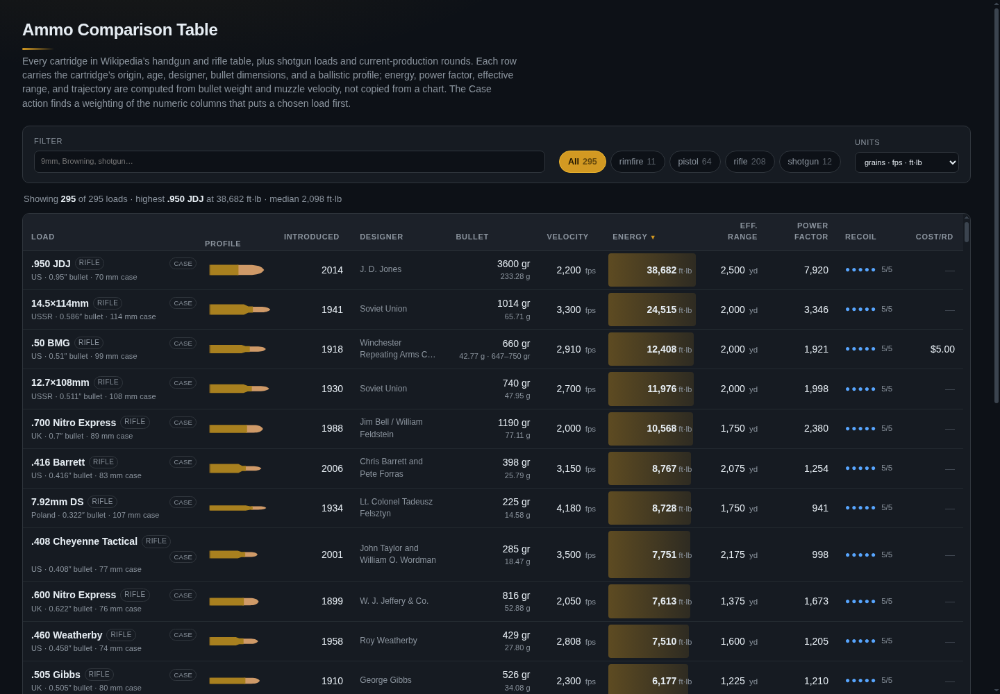
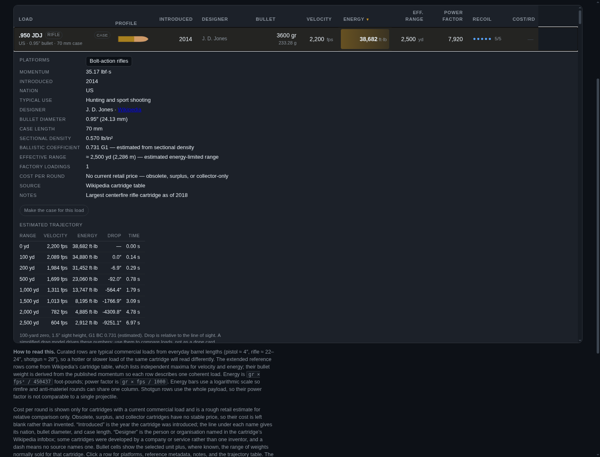
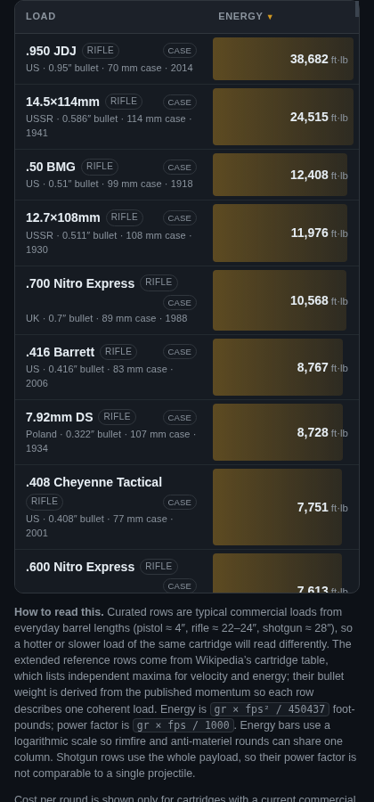
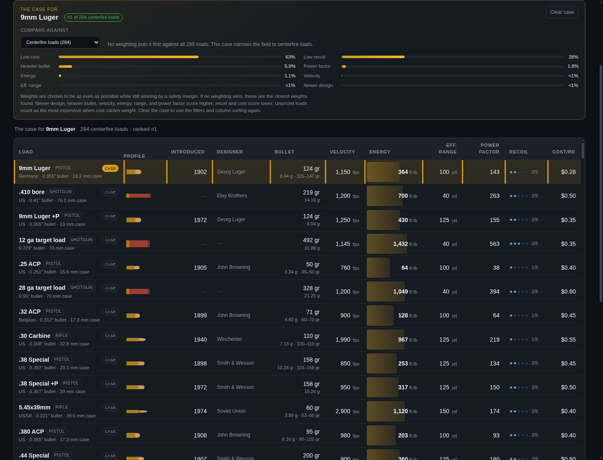

# Ammo Comparison Table — Design



One page, one job: let you compare a shelf of ammunition by the numbers that
actually differ between loads. Everything else — units, sorting, filtering — is
there so the comparison is quick, not so the page has features.

## Where the numbers come from

`data/ammo.js` stores what a load *is*:

```js
{ id, name, category, bulletGr, velocityFps, costPerRound?, recoil, use, platforms, notes }
```

`costPerRound` is optional. It is present only for the curated loads that have a
current commercial equivalent; reference rows are deliberately unpriced.

Reference rows may also carry `introduced`, `nation`, `diameterIn`, `bc`,
`caseLengthMm`, `factoryLoadings`, `commonGrains`, and `source`. `commonGrains`
is a `[low, high]` pair describing the bullet weights normally sold for the
cartridge — the row's own `bulletGr` always sits inside it. `data/inventors.js`
adds the designer/developing organisation from the English Wikipedia infobox;
it is a separate overlay so the automated source stays auditable and the core
load data is not rewritten by a scraper.

Derived values are never stored. `lib/ballistics.js` computes them:

| Value | Formula | Notes |
|---|---|---|
| Muzzle energy (ft·lb) | `gr × fps² / 450437` | `450437 = 2 · 7000 · 32.174` folds in grains-per-pound and gravity |
| Muzzle energy (J) | `ft·lb × 1.3558179` | |
| Power factor | `gr × fps / 1000` | Imperial shooting-sports momentum figure; 125 minor / 165 major |
| Momentum (lbf·s) | `gr × fps / 225218.34` | The `P` column in Wikipedia's cartridge table |
| Metric momentum | `kg × m/s` | What the metric toggle shows in the power-factor column |
| Velocity (m/s) | `fps × 0.3048` | |
| Bullet mass (g) | `gr × 0.06479891` | |

Keeping the math in one module is the point: the UI, the tests, and anything
added later all read the same implementation, so an energy column can never
disagree with a velocity column.

`lib/trajectory.js` carries the exterior-ballistics model. Its inputs are the
row's bullet weight, diameter, muzzle velocity, and class; a published G1 BC is
used where the data has one (85 rows), otherwise the BC is estimated as
sectional density divided by a shape form factor. Velocity decays
exponentially, `v(x) = v0 · exp(-k·x)` with `k = 0.000438 · BC^-0.53`, fitted
to published G1 tables. Time of flight, retained energy, and drop relative to
the line of sight follow from that curve. Pistols and rimfires use a 50-yard
zero and a 1″ sight height; rifles and shotguns use 100 yards and 1.5″.

The **Eff. range** column is the farthest 25-yard step at which the load still
carries a role energy floor: 75 ft·lb for rimfire, 300 for pistols, 250 for
varmints, and 1,000 for other rifles. The floor is capped at 75% of muzzle
energy so weak legacy rounds still get a finite answer, and practical caps keep
pistol, rimfire, varmint, and anti-materiel figures in the range people actually
shoot. Shot shells are pattern-limited (40 yd), slugs use 100 yd, and sabots
150 yd. These are comparison estimates, not manufacturer claims; the page says
so in the footnote and on every expanded row.

`lib/cartridge-svg.js` turns the same stored dimensions into the row profiles. It
estimates projectile length from bullet mass and lead density, infers a neck from
case proportions and velocity, and emits one inline SVG per load. Where SAAMI or
C.I.P. publishes a drawing, `data/dimensions.js` supplies the base, neck, rim, and
rim height that would otherwise be inferred. Nothing is downloaded and there are no
per-cartridge image assets, so fixing a case length or bullet diameter immediately
fixes that row's drawing.

## Coverage

The curated section covers the loads someone is most likely to compare. The
extended reference set adds every cartridge in Wikipedia's [Table of handgun and
rifle cartridges](https://en.wikipedia.org/wiki/Table_of_handgun_and_rifle_cartridges)
that has usable published data, plus current-production rounds (`.22 ARC`, 6.5
PRC, 7mm PRC, `.300 PRC`, `.277 Fury`, 8.6 Blackout, `.400 Legend`) and shotgun
loads that the Wikipedia table does not include (10 ga, 16 ga, 20 ga target,
3″ 00 buck, sabot slugs, `.410` slug).

Designer coverage is 270 of 295 loads. The rest are mostly shot shells (which
have no single designer), obscure military experiments, and a few wildcats whose
Wikipedia infobox leaves the field blank; those rows show a dash rather than a
guess. `+P` rows inherit their parent cartridge's designer.

Cost per round is only present for the 68 cartridges in the curated sets, where
a current commercial load exists and a retail estimate is meaningful. The
reference rows are deliberately unpriced: many are obsolete, surplus, or
collector-only, so attaching a dollar figure would invent data rather than
report it. Unpriced rows sort to the bottom in both directions.

## SAAMI and CIP validation

The silhouettes are generated, so they can be checked against the standards
instead of being taken on faith. Thirty-nine cartridges (42 rows, because +P
variants share a drawing) have published dimensions from ANSI/SAAMI Z299 or
C.I.P. TDCC; those values live in `data/dimensions.js` and are asserted in
`tests/dimensions.test.mjs`.

Where a published drawing exists, the profile uses its base, neck, rim, and rim
height. That also settles edge cases the inference cannot see: .350 Legend and
.450 Bushmaster have rebated rims (the rim is narrower than the case body), and
belted magnums step out at the belt rather than the base. The C.I.P. sheets cover
large military rounds SAAMI does not standardise, including .50 BMG, 12.7×108,
14.5×114, .416 Barrett, and .408 CheyTac.

Measured against those 42 rows:

| Dimension | Source | Median error | Worst error |
|---|---|---|---|
| Bullet diameter | load data (published) | 0.03 mm | 0.09 mm |
| Case length | load data (published) | 0.05 mm | 1.26 mm |
| Base diameter | published reference | exact | exact |
| Base diameter | inferred fallback | 0.43 mm | 4.02 mm (20%) |
| Neck diameter | inferred fallback | 0.12 mm | 0.93 mm (19%) |
| Rim diameter | inferred fallback | 1.29 mm | 3.92 mm |

The largest case-length gap is the .410 slug row, which uses a nominal 2.48″
figure rather than the standard's 2.53″ maximum. The fallback's worst relative
errors are small-case varmint rounds and .300 Blackout, whose case family cannot
be inferred from bullet diameter and case length alone; the largest absolute base
and rim gaps are .416 Barrett and 14.5×114. Rim error largely follows base error:
a rimless rim is only about 0.1 mm wider than the body, so whatever the base gets
wrong carries straight through.

Rows without a published drawing — many are obsolete, military, or wildcat
designs — are therefore schematics within roughly the band above, not measured
drawings. The test enforces 0.1 mm on bullet diameter, 1.5 mm on case length, and
a 30% band on the inferred base and rim so a regression cannot quietly widen the
gap.

## Data caveats (deliberate, and stated on the page)

- **Curated rows are typical, not maximum loads.** Pistol ≈ 4″, rifle ≈ 22–24″,
  shotgun ≈ 28″. The same cartridge in a different barrel reads differently — that
  is physics, not an error in the table.
- **Wikipedia rows are built from independent maxima.** The source table reports
  the highest velocity and the highest energy it found, which may come from
  different loads. To keep each row physically coherent, bullet weight is derived
  from the published momentum column (or from velocity and energy when momentum
  is missing). The resulting energy can therefore differ from the source table's
  maximum-energy figure.
- **Shotgun rows use the whole payload** (9 pellets of 00 buck, a 1 oz slug).
  Their energy is real, but their power factor is not comparable to a single
  projectile, and the page says so.
- **Cost per round is a rough retail estimate**, and only for cartridges that
  have a current commercial load. Obsolete and collector rounds are unpriced by
  design; there is no honest single number for them.

## Layout and interaction

- The table spans the full window width; it is a reference grid, so there is no
  reason to squeeze it into a reading column.
- Each row carries the cartridge's origin, introduction year, bullet diameter,
  and case length under its name, plus the usual bullet-weight range in the
  bullet cell. The designer and estimated effective range have their own
  columns; sorting by range answers "what actually reaches" faster than reading
  295 rows.
- The expanded row adds a trajectory table (range, velocity, energy, drop, time)
  sampled out to the effective range, plus sectional density, the BC and its
  provenance, the designer link, and the usual reference metadata. Shot charges
  get a pattern-limit note instead of a single-projectile table.


- The profile column draws each cartridge from its stored dimensions and bullet
  mass: case length sets the body, bullet diameter sets the neck and width, and
  mass divided by lead density estimates projectile length. Where SAAMI or C.I.P.
  publishes a drawing, the base, neck, rim, and rim height come from the standard
  (`data/dimensions.js`); elsewhere they are inferred. The ogive is always an
  approximation, so the drawings are schematic rather than engineering drawings.
  Silhouettes share a compressed scale (`length^0.55`) so a 2 mm Kolibri stays
  legible beside a 14.5×114mm while true proportions and ordering are preserved;
  the printed dimensions remain authoritative. `lib/cartridge-svg.js` is the
  single source for the geometry, and every drawing is self-contained inline SVG.
- Sticky header row; the load column stays pinned on narrow screens so you never
  lose track of which row you are reading.
- Sortable headers use `aria-sort`; the default is energy, descending, because
  that is what most comparisons are actually about. Clicking a header cycles
  descending → ascending; text columns start ascending.
- Energy cells draw a logarithmic bar scaled to the highest-energy load in the
  whole dataset, so the bar means the same thing no matter what is filtered out.
  A linear scale would collapse everything below `.50 BMG` once the anti-materiel
  rounds are included.
- Scrollbars inside the table and on the page are themed to match the panel;
  the default light scrollbar reads as a rendering bug on a dark surface.
- Rows are `tabindex="0"` and toggle detail with Enter/Space as well as click.
- Empty filter states keep the summary line honest rather than showing a blank
  table.

### Narrower windows

Columns drop in priority order rather than shrinking into unreadable slivers:
typical use below 1500 px, cost and recoil below 1200 px, designer below
1050 px, introduction year below 950 px, power factor below 860 px, velocity
and range below 760 px, and everything but the load and its energy on phones.
The detail row still carries every dropped field.

### On a phone



Below 720 px the table keeps only the load and its energy, which fits without
sideways scrolling; the name keeps its origin-and-dimensions subline. The
category chips wrap, the unit selector drops to its own row, and the detail rows
still work.

## Make the case

Sorting answers “which load has the most velocity, energy, or range?” The Case
action asks a different question: is there a non-negative weighting of the
numeric columns that puts *this* load first? Every row has a Case button, and
the expanded detail has a “Make the case for this load” button. The panel shows
the weights, the comparison set, the resulting rank, and the rows still ahead
when the case loses.

The eight columns are the numeric table columns: introduction year, bullet
weight, velocity, energy, effective range, power factor, recoil, and cost.
Higher is better for year, bullet weight, velocity, energy, range, and power
factor; lower is better for recoil and cost. Each column becomes a percentile
within the comparison set, so the weights are shares of a rank argument rather
than physical units. A missing year is treated as oldest; a missing price is
treated as most expensive. The latter matters because 227 reference loads are
deliberately unpriced.

| Comparison set | Rows |
|---|---:|
| All loads | 295 |
| Centerfire loads | 284 |
| Rimfire loads | 11 |
| Pistol loads | 64 |
| Rifle loads | 208 |
| Shotgun loads | 12 |

The default is the broadest set in which the load can win: all loads first,
then centerfire (or rimfire), then its own category. That is why 9mm Luger
opens against centerfire loads rather than all loads: no weighting puts it
first across the whole table, but excluding rimfire makes a case possible. The
“Compare against” menu exposes the same sets, so the failure against all loads
is visible rather than hidden. If no set can put the load first, the panel says
so and reports the closest case found; it never silently forces the selected
row to the top. A tie between closest sets goes to the narrower set, which is
usually the more useful comparison.

As of the checked-in dataset, **96 of 295 loads have a strict case** in their
auto-selected set. The rest report a closest case instead of pretending.



### How the weights are found

`tools/build-cases.py` precomputes the weightings into `data/cases.js`; the
browser only evaluates the stored weights against the same percentile scale.
For each load and comparison set:

1. A max-margin linear program finds the largest possible score gap. If the
   gap is below 0.0001, there is no strict case.
2. If a case exists, a second optimization maximizes weight entropy subject to
   a margin of at least half the maximum gap (capped at one percentile point).
   That picks the most even mix that still wins by a safety margin, instead of
   putting 100% on one column or settling for a numerical tie.
3. If no case exists, a deterministic Dirichlet search over the weight simplex,
   followed by local perturbations, finds a low-rank weighting. The UI calls
   this “closest found”; rank minimization over a step function is not an LP, so
   it is a search result, not a proof of optimality.
4. Weights are rounded to eight decimals. `tests/cases.test.mjs` recomputes every
   stored rank and margin with the browser math, so generator/browser drift
   fails offline.

The current data produces these illustrative cases (weights rounded):

| Load | Set | Result | Largest weights |
|---|---|---|---|
| `.223 Rem` | all | #1 | cost 29%, recoil 25%, range 11% |
| `9mm Luger` | centerfire | #1 | cost 63%, recoil 28%, bullet 6% |
| `9mm Luger` | all (override) | closest found #2 | cost 84%, energy 12%, recoil 4% |
| `.45 ACP` | pistol | #1 | cost 42%, bullet 28%, recoil 15% |
| `.357 Magnum` | pistol | #1 | range 28%, recoil 24%, cost 20% |
| `.380 ACP` | pistol | no winner; closest found #3 | cost 79%, velocity 12%, recoil 9% |
| `.50 BMG` | all | #1 | near-even: cost 15%, other columns 10–13% |

The weights are not a claim that cost matters 63% “in reality.” They are the
least-contrived weighting that makes the selected load win this particular
comparison, and the panel shows them so the argument can be inspected. Two
other caveats are deliberate: effective range is an estimate from the
trajectory model, and “newer design” / “heavier bullet” are directional
preferences, not performance metrics.

Regenerate the file after changing the load data or criteria:

```
nix-shell -p python3Packages.scipy python3Packages.numpy --run \
  "python3 tools/build-cases.py"
```

The generator shells out to `node tools/export-case-rows.mjs` for the enriched
rows, so Node and SciPy are both required. The app itself stays dependency-free
and the generated file is checked in.

## Tests

`tests/ballistics.test.mjs` (node:test, no dependencies) checks:

- reference energies against hand-computed values (9mm 124/1150 ≈ 364 ft·lb),
- the `v²` relationship,
- unit conversions, including momentum in lbf·s,
- that every load carries the fields the table renders,
- unique ids (row expansion is keyed on them),
- that the extended reference set is present (≥290 loads, Wikipedia provenance,
  plausible bullet weights, spot checks for the long tail),
- that curated rows carry the same origin/year/dimension metadata as the
  reference set,
- that every `commonGrains` range is ordered and contains the load it describes,
- that only curated loads carry a price and reference rows stay unpriced,
- introduction years that fall between 1800 and today,
- energy ordering that matches shooter intuition (`.22 LR < 9mm < .223`,
  `.308 < .300 Win Mag`, and the 1 oz 12 ga slug outgunning a .30-06).

`tests/silhouette.test.mjs` checks the generated profiles without opening a
browser: every load emits a finite inline SVG, all drawings share one viewBox,
nothing references an external resource, drawn length and width follow the stored
dimensions, bottleneck and rim inference land on the right cartridges, shotgun
hulls contain no protruding bullet, and missing metadata falls back instead of
producing `NaN`.

`tests/trajectory.test.mjs` checks the exterior-ballistics model: published BCs
win over estimates, estimated BCs stay in band, velocity/time/energy are
monotonic and consistent, each class crosses its zero at the right distance,
effective ranges land in the expected order (`.22 LR < .223`, `9mm < .308 <
.50 BMG`), shot shells are pattern-limited, and every one of the 295 loads
produces finite samples.

`tests/inventors.test.mjs` keeps the designer overlay honest: every key is a
real load, coverage stays above 260 rows, +P aliases match their parent, the
well-known cartridges name their designers, and no value leaks wiki markup or
HTML entities.

`tests/dimensions.test.mjs` is the accuracy check: it maps 42 rows to ANSI/SAAMI
Z299 and C.I.P. TDCC drawings, verifies the dataset's bullet diameter and case
length agree with the reference, requires the overlay to drive base/neck/rim
exactly, keeps the inferred fallback inside its documented error band, and
covers rebated rims.

`tests/cases.test.mjs` checks the generated weighting table: every load has a
case and every referenced scope is known; all 874 load/scope results have
non-negative weights that sum to one; the browser percentile math reproduces
every stored rank and margin; feasible results are strictly #1; the known
fallbacks are `.223`/all, 9mm/centerfire, `.45 ACP` and `.357 Magnum`/pistol,
and `.50 BMG`/all; and `.380 ACP` has no winning scope and reports its closest
pistol rank.

```
node --test tests/*.test.mjs
```

`tests/interaction.check.mjs` drives the real page over the Chrome DevTools
Protocol — no Playwright install and no browser download, which matters on this
NixOS host — and asserts filtering, sorting, row expansion, the unit toggle,
silhouette rendering, designer/range columns, trajectory tables, designer
search, the empty state, and the Make the case flow (9mm's centerfire fallback,
widening it back to all loads, `.223`/all, `.45 ACP`/pistol, `.380 ACP` with no
winner, clear/restore, and a phone-width panel).

Both suites are offline. The unit tests import the checked-in dataset directly;
the browser check talks only to `localhost` (your `server.mjs` and Chrome's
debugging port). Nothing fetches Wikipedia or any other remote source.

```
node server.mjs &
google-chrome --headless=new --no-sandbox --remote-debugging-port=9222 \
  --user-data-dir=/tmp/ammo-chrome about:blank &
APP_URL=http://localhost:5113/ node tests/interaction.check.mjs
```
