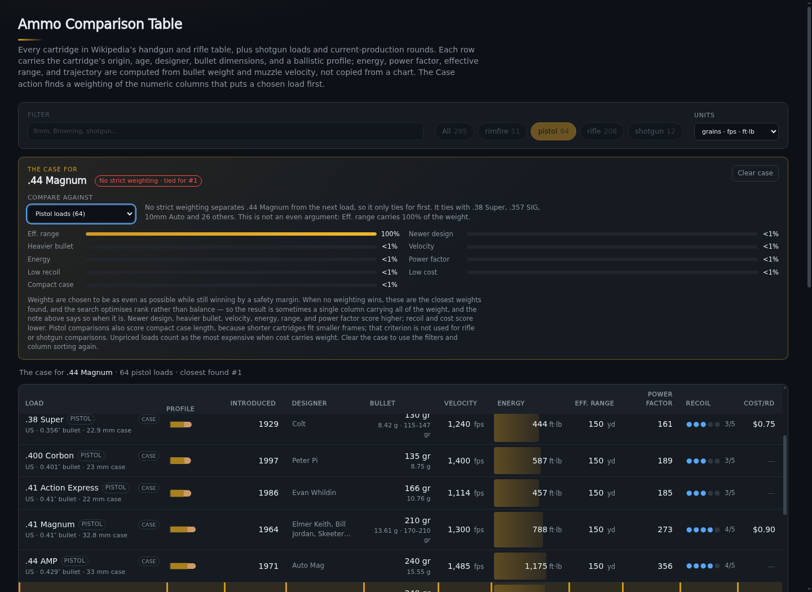

# Ammo Comparison Table — Design


One page, one job: let you compare a shelf of ammunition by the numbers that
actually differ between loads. Everything else — units, sorting, filtering — is
there so the comparison is quick, not so the page has features.

## Where the numbers come from

`data/ammo.js` stores what a load *is*:

```js
{ id, name, category, bulletGr, velocityFps, costPerRound?, use, platforms, notes }
```

`costPerRound` is optional. It is present only for the curated loads that have a
current commercial equivalent; reference rows are deliberately unpriced.

Recoil is **not** stored. It used to be a hand-typed 1-5 rating, which scored
.380 ACP and 9mm Luger identically at 2/5; it is now derived in `lib/recoil.js`
(see below), like energy and trajectory.

Reference rows may also carry `introduced`, `nation`, `diameterIn`, `bc`,
`caseLengthMm`, `factoryLoadings`, `commonGrains`, and `source`. `commonGrains`
is a `[low, high]` pair describing the bullet weights normally sold for the
cartridge — the row's own `bulletGr` always sits inside it. `data/inventors.js`
adds the designer/developing organisation from the English Wikipedia infobox;
it is a separate overlay so the automated source stays auditable and the core
load data is not rewritten by a scraper.

Derived values are never stored. `lib/ballistics.js` computes them:

| Value | Formula | Notes |
|---|---|---|
| Muzzle energy (ft·lb) | `gr × fps² / 450437` | `450437 = 2 · 7000 · 32.174` folds in grains-per-pound and gravity |
| Muzzle energy (J) | `ft·lb × 1.3558179` | |
| Power factor | `gr × fps / 1000` | Imperial shooting-sports momentum figure; 125 minor / 165 major |
| Momentum (lbf·s) | `gr × fps / 225218.34` | The `P` column in Wikipedia's cartridge table |
| Metric momentum | `kg × m/s` | What the metric toggle shows in the power-factor column |
| Velocity (m/s) | `fps × 0.3048` | |
| Bullet mass (g) | `gr × 0.06479891` | |

Keeping the math in one module is the point: the UI, the tests, and anything
added later all read the same implementation, so an energy column can never
disagree with a velocity column.

`lib/recoil.js` carries the recoil model. A cartridge does not have a recoil; a
cartridge *in a gun* does, so the column stores the free recoil energy in a
reference gun for the load's class:

| Value | Formula | Notes |
|---|---|---|
| Recoil impulse (lbf·s) | `gr × fps / 7000` | The momentum the hand or shoulder absorbs |
| Free recoil (ft·lb) | `impulse² / (2 · gun lb · 32.174)` | Energy scales inversely with gun weight |
| Free recoil (J) | `ft·lb × 1.3558179` | |
| Dot level (1-5) | bounds `0.5 / 2 / 5 / 12 ft·lb` | Fixed bounds, so a dot keeps its meaning as rows are added |

| Class | Reference gun | Why |
|---|---|---|
| Rimfire | 5 lb | A .22 rifle; rimfire pistols are lighter, so their recoil is understated |
| Pistol | 2 lb | A service or compact pistol (~32 oz) |
| Rifle | 8 lb | A 22–24″ sporter with a scope |
| Shotgun | 7.5 lb | A 28″ field gun |

Two simplifications, both stated on the page: propellant gas momentum is ignored
(a few percent for pistols, understating magnum rifle and shotgun recoil by
roughly a fifth to a third), and one reference mass stands in for a whole class
the same way the barrel lengths do. The row detail prints the energy, the
impulse, and the reference gun so the assumption is never hidden.

The payoff is resolution where it matters: .380 ACP (1.37 ft·lb) and 9mm Luger
(3.22 ft·lb) are now 2/5 and 3/5 instead of both 2/5, and the 28-way tie at 2/5
that the hand-typed column produced is gone.

`lib/trajectory.js` carries the exterior-ballistics model. Its inputs are the
row's bullet weight, diameter, muzzle velocity, and class; a published G1 BC is
used where the data has one (85 rows), otherwise the BC is estimated as
sectional density divided by a shape form factor. Velocity decays
exponentially, `v(x) = v0 · exp(-k·x)` with `k = 0.000438 · BC^-0.53`, fitted
to published G1 tables. Time of flight, retained energy, and drop relative to
the line of sight follow from that curve. Pistols and rimfires use a 50-yard
zero and a 1″ sight height; rifles and shotguns use 100 yards and 1.5″.

The **Eff. range** column is the farthest 25-yard step at which the load still
carries a role energy floor: 75 ft·lb for rimfire, 300 for pistols, 250 for
varmints, and 1,000 for other rifles. The floor is capped at 75% of muzzle
energy so weak legacy rounds still get a finite answer, and practical caps keep
pistol, rimfire, varmint, and anti-materiel figures in the range people actually
shoot. Shot shells are pattern-limited (40 yd), slugs use 100 yd, and sabots
150 yd. These are comparison estimates, not manufacturer claims; the page says
so in the footnote and on every expanded row.

`lib/cartridge-svg.js` turns the same stored dimensions into the row profiles. It
estimates projectile length from bullet mass and lead density, infers a neck from
case proportions and velocity, and emits one inline SVG per load. Where SAAMI or
C.I.P. publishes a drawing, `data/dimensions.js` supplies the base, neck, rim, and
rim height that would otherwise be inferred. Nothing is downloaded and there are no
per-cartridge image assets, so fixing a case length or bullet diameter immediately
fixes that row's drawing.

## Coverage

The curated section covers the loads someone is most likely to compare. The
extended reference set adds every cartridge in Wikipedia's [Table of handgun and
rifle cartridges](https://en.wikipedia.org/wiki/Table_of_handgun_and_rifle_cartridges)
that has usable published data, plus current-production rounds (`.22 ARC`, 6.5
PRC, 7mm PRC, `.300 PRC`, `.277 Fury`, 8.6 Blackout, `.400 Legend`) and shotgun
loads that the Wikipedia table does not include (10 ga, 16 ga, 20 ga target,
3″ 00 buck, sabot slugs, `.410` slug).

Designer coverage is 270 of 295 loads. The rest are mostly shot shells (which
have no single designer), obscure military experiments, and a few wildcats whose
Wikipedia infobox leaves the field blank; those rows show a dash rather than a
guess. `+P` rows inherit their parent cartridge's designer.

Cost per round is only present for the 68 cartridges in the curated sets, where
a current commercial load exists and a retail estimate is meaningful. The
reference rows are deliberately unpriced: many are obsolete, surplus, or
collector-only, so attaching a dollar figure would invent data rather than
report it. Unpriced rows sort to the bottom in both directions.

## Products: the boxes on the shelf

A cartridge row says what a cartridge *is*. A product row says which specific
loading of it you can buy — one row per real product line, pointing at the
cartridge it chambers. Everything geometric (bullet diameter, case length,
silhouette, designer, legality) is inherited from the cartridge, so the two
layers cannot disagree: fix a case length once and every box of that cartridge
follows. What a product adds is what differs between two boxes of the same
cartridge:

```js
{ id, cartridge, brand, line, sku?, bulletGr, bulletType?, packageRounds,
  velocityFps?, velocitySource, priceUsd?, priceSource?, priceChecked?, source }
```

| Field | Rule |
|---|---|
| `cartridge` | An id from `data/ammo.js`. A row pointing nowhere fails validation. |
| `source` | Required. Where the row came from. "I remember this one" is not a source. |
| `priceUsd` | Optional, and **never guessed**. A price also needs `priceSource` and `priceChecked`, so a stale price can be found and re-read. |
| `packageRounds` | The box size the price refers to. Prices are shown per round, so a 20-round box and a 50-round box compare. |
| `velocityFps` | Optional. Published figures carry `velocitySource: 'manufacturer'`; without one the row borrows the cartridge's reference velocity and says so in its detail. |

The table gains a **Products** view beside **Cartridges**: same columns, same
filters, same units, with brand and line in the load cell, the box size and SKU
underneath, and no Case action (cases are solved per cartridge). Prices only
appear when a listing was captured; otherwise the cell shows a dash and the
detail row says “no listing captured”.

### Importing a real catalog

The app never fetches anything, and neither does the importer. You hand it a file
you already have — a manufacturer spec sheet exported to CSV, a retailer listing
export, a spreadsheet — and it validates, derives, and writes the checked-in
catalog:

```
node tools/import-products.mjs catalog.csv            # validate + write
node tools/import-products.mjs catalog.csv --check    # exit 1 if stale
node tools/import-products.mjs catalog.json --dry-run # summary only
```

CSV columns: `id, cartridge, brand, line, sku, bulletGr, bulletType,
packageRounds, velocityFps, priceUsd, priceSource, priceChecked, source`.
Unknown columns are ignored, so an export can be fed in as-is. The importer
rejects a row that breaks a sourcing rule rather than writing it.

**The checked-in catalog is a fixture.** Its 12 rows exist to exercise the
schema, the importer, and the view; they are not a claim about current prices or
availability, and the app shows an “example catalog” notice while that is true.
The moment a real export is imported, `CATALOG_IS_FIXTURE` turns false and the
notice disappears.

## SAAMI and CIP validation

The silhouettes are generated, so they can be checked against the standards
instead of being taken on faith. Thirty-five published drawings cover 42 rows
(+P variants and same-gauge shot shells share one) from ANSI/SAAMI Z299 or
C.I.P. TDCC; those values live in `data/dimensions.js` and are asserted in
`tests/dimensions.test.mjs`.

Where a published drawing exists, the profile uses its base, neck, rim, and rim
height. That also settles edge cases the inference cannot see: .350 Legend and
.450 Bushmaster have rebated rims (the rim is narrower than the case body), and
belted magnums step out at the belt rather than the base. The C.I.P. sheets cover
large military rounds SAAMI does not standardise, including .50 BMG, 12.7×108,
14.5×114, .416 Barrett, and .408 CheyTac.

Measured against those 42 rows:

| Dimension | Source | Median error | Worst error |
|---|---|---|---|
| Bullet diameter | load data (published) | 0.03 mm | 0.09 mm |
| Case length | load data (published) | 0.05 mm | 1.26 mm |
| Base diameter | published reference | exact | exact |
| Base diameter | inferred fallback | 0.43 mm | 4.02 mm (20%) |
| Neck diameter | inferred fallback | 0.12 mm | 0.93 mm (19%) |
| Rim diameter | inferred fallback | 1.29 mm | 3.92 mm |

The largest case-length gap is the .410 slug row, which uses a nominal 2.48″
figure rather than the standard's 2.53″ maximum. The fallback's worst relative
errors are small-case varmint rounds and .300 Blackout, whose case family cannot
be inferred from bullet diameter and case length alone; the largest absolute base
and rim gaps are .416 Barrett and 14.5×114. Rim error largely follows base error:
a rimless rim is only about 0.1 mm wider than the body, so whatever the base gets
wrong carries straight through.

Rows without a published drawing — many are obsolete, military, or wildcat
designs — are therefore schematics within roughly the band above, not measured
drawings. The test enforces 0.1 mm on bullet diameter, 1.5 mm on case length, and
a 30% band on the inferred base and rim so a regression cannot quietly widen the
gap.

## Legality

Legality is not a trade-off like cost or recoil — a load may be possessed by a
civilian in a jurisdiction or it may not, and the answer comes from statute, not
physics — so it is deliberately **not** a Case criterion. It is a hard filter and
a row annotation instead.

`data/legality.js` holds one rule per (jurisdiction, statutory test) plus the
exceptions where the statute and a diameter rule disagree:

| Jurisdiction | Scope | Basis | Rule |
|---|---|---|---|
| Mexico | civilian possession | Ley Federal de Armas de Fuego, Art. 10 | Pistols outside .22/.25/.32/.380 are reserved; rifles above .30 calibre are reserved |
| Italy | civilian ownership | L. 110/1975 and the military-calibre list | 9×19 Parabellum is a military calibre; 9×21 IMI is the legal substitute |
| Canada | prohibited firearms | Criminal Code s.84(1) | Handguns in .25 or .32 calibre are prohibited outright |

Mexico is the reason the overlay is written by calibre designation rather than
bullet diameter. .380 ACP and 9mm Parabellum both use a .355″ bullet, but only
.380 is on the permitted list — and .38 Special revolvers are permitted while
.357 Magnum, the same .357″ bullet, is not. Those two pairs are the exceptions
table, and the tests pin them:

```js
'38sp': { MX: null },          // Art. 10 lists .38 Special revolvers
'32-20-winchester': { MX: null } // a permitted revolver calibre, not a rifle one
```

On the page, restricted rows carry a small jurisdiction badge (`MX IT`) with the
reason in its tooltip, the detail row spells out each jurisdiction's rule, and
the **“Legal for civilians in”** control filters the table to loads that pass
that jurisdiction's rules. Category chips count only the loads that pass, so the
counts never contradict the rows. The Case feature also gets one comparison set
per jurisdiction (see [Make the case](#make-the-case)), built from these same
rules rather than a second copy of them.

Two limits worth stating. Long-gun and shotgun rules are modelled only where they
are a simple calibre test (Mexico's .30-calibre line); transport, carry, magazine
and feature restrictions are not modelled at all, and Canada's barrel-length rule
is a property of the firearm rather than the cartridge. And this is a summary for
comparison, **not legal advice** — each jurisdiction records its source and the
month it was last checked, so the summary can be re-read against the statute.

## Data caveats (deliberate, and stated on the page)

- **Curated rows are typical, not maximum loads.** Pistol ≈ 4″, rifle ≈ 22–24″,
  shotgun ≈ 28″. The same cartridge in a different barrel reads differently — that
  is physics, not an error in the table.
- **Wikipedia rows are built from independent maxima.** The source table reports
  the highest velocity and the highest energy it found, which may come from
  different loads. To keep each row physically coherent, bullet weight is derived
  from the published momentum column (or from velocity and energy when momentum
  is missing). The resulting energy can therefore differ from the source table's
  maximum-energy figure.
- **Shotgun rows use the whole payload** (9 pellets of 00 buck, a 1 oz slug).
  Their energy is real, but their power factor is not comparable to a single
  projectile, and the page says so.
- **Cost per round is a rough retail estimate**, and only for cartridges that
  have a current commercial load. Obsolete and collector rounds are unpriced by
  design; there is no honest single number for them.
- **Recoil is a cartridge-plus-gun figure.** The column is free recoil energy in a
  reference gun for the class, not a rating of how a particular pistol feels.
  Propellant gas is ignored, which understates magnum rifle and shotgun recoil.
- **Legality is a curated summary, not legal advice.** It covers three
  jurisdictions, records the statute it was read from, and depends on the firearm
  as well as the cartridge.

## Layout and interaction

- The table spans the full window width; it is a reference grid, so there is no
  reason to squeeze it into a reading column.
- Each row carries the cartridge's origin, introduction year, bullet diameter,
  and case length under its name, plus the usual bullet-weight range in the
  bullet cell. The designer and estimated effective range have their own
  columns; sorting by range answers "what actually reaches" faster than reading
  295 rows.
- The expanded row adds a trajectory table (range, velocity, energy, drop, time)
  sampled out to the effective range, plus sectional density, the BC and its
  provenance, the designer link, and the usual reference metadata. Shot charges
  get a pattern-limit note instead of a single-projectile table.


- The profile column draws each cartridge from its stored dimensions and bullet
  mass: case length sets the body, bullet diameter sets the neck and width, and
  mass divided by lead density estimates projectile length. Where SAAMI or C.I.P.
  publishes a drawing, the base, neck, rim, and rim height come from the standard
  (`data/dimensions.js`); elsewhere they are inferred. The ogive is always an
  approximation, so the drawings are schematic rather than engineering drawings.
  Silhouettes share a compressed scale (`length^0.55`) so a 2 mm Kolibri stays
  legible beside a 14.5×114mm while true proportions and ordering are preserved;
  the printed dimensions remain authoritative. `lib/cartridge-svg.js` is the
  single source for the geometry, and every drawing is self-contained inline SVG.
- Sticky header row; the load column stays pinned on narrow screens so you never
  lose track of which row you are reading.
- Sortable headers use `aria-sort`; the default is energy, descending, because
  that is what most comparisons are actually about. Clicking a header cycles
  descending → ascending; text columns start ascending.
- Energy cells draw a logarithmic bar scaled to the highest-energy load in the
  whole dataset, so the bar means the same thing no matter what is filtered out.
  A linear scale would collapse everything below `.50 BMG` once the anti-materiel
  rounds are included.
- Scrollbars inside the table and on the page are themed to match the panel;
  the default light scrollbar reads as a rendering bug on a dark surface.
- Rows are `tabindex="0"` and toggle detail with Enter/Space as well as click.
- Empty filter states keep the summary line honest rather than showing a blank
  table.

### Narrower windows

Columns drop in priority order rather than shrinking into unreadable slivers:
typical use below 1500 px, cost and recoil below 1200 px, designer below
1050 px, introduction year below 950 px, power factor below 860 px, velocity
and range below 760 px, and everything but the load and its energy on phones.
The detail row still carries every dropped field.

### On a phone


Below 720 px the table keeps only the load and its energy, which fits without
sideways scrolling; the name keeps its origin-and-dimensions subline. The
category chips wrap, the unit selector drops to its own row, and the detail rows
still work.

## Make the case

Sorting answers “which load has the most velocity, energy, or range?” The Case
action asks a different question: is there a non-negative weighting of the
numeric columns that puts *this* load first? Every row has a Case button, and
the expanded detail has a “Make the case for this load” button. The panel shows
the weights, the comparison set, the resulting rank, and the rows still ahead
when the case loses. It also states the **size of the win** — “it wins by 0.9
percentile points over 9mm Luger +P”, or “it sits 11.7 percentile points behind
.300 Whisper” — because a one-point win and a ten-point win are not the same
argument, and the panel should not make them look alike.

The shared criteria are the seven numeric table columns: introduction year,
bullet weight, velocity, energy, effective range, derived free recoil, and cost.
Pistol comparisons add an eighth, compact case length, because shorter
cartridges are what let small pistols exist; that criterion is deliberately not
used against rifles or shotguns. Higher is better for year, bullet weight,
velocity, energy, and range; lower is better for recoil, cost, and compact case.
Power factor is deliberately **not** a criterion. Recoil energy is momentum
squared over twice the gun mass, so inside a class — where the reference mass is
fixed — power factor and recoil are the same measurement in different units.
Weighting both creates a null direction that scores every load identically: the
first build of the derived-recoil column did exactly that, and `.357 Magnum`
“tied for first” with all 63 other pistol loads. Power factor stays a displayed
column; recoil carries the argument, because it is what the shooter feels.
`tests/cases.test.mjs` now rejects any stored weighting whose scores barely
spread across its comparison set. Each criterion becomes a percentile among the
members that have a value, so the weights are shares of a rank argument rather
than physical units. A missing year, price, or case length is not an
observation: it sits at the worst end (0) rather than being ranked, which is why
unpriced loads cannot make a priced load look cheap, and why the 227 unpriced loads
never win a cost argument by default. A zero case length is
treated as unknown, not as the shortest case.

| Comparison set | Rows |
|---|---:|
| All loads | 295 |
| Centerfire loads | 284 |
| Rimfire loads | 11 |
| Pistol loads | 64 |
| Rifle loads | 208 |
| Shotgun loads | 12 |
| Loads legal in Mexico | 149 |
| Loads legal in Italy | 293 |
| Loads legal in Canada | 289 |

The jurisdiction sets come from `data/legality.js` through the same rules the
table filters on — the generator never keeps its own copy of the law. Start a
case while the jurisdiction filter is active and the panel opens in that set:
“make the case for .380 ACP among loads legal in Mexico” is the question the
filter implies. A load that is restricted there is never offered that set, and
the result is often a lesson: `.380 ACP` wins its pistol case and then cannot
win among Mexican-legal loads at all, because the 9mm it is usually measured
against is not in that set and the .22/.25/.32 rounds beat it on compactness and
cost. Rank 4 of 149, reported as a closest case rather than a win.

The default is the broadest set in which the load can win: all loads first,
then centerfire (or rimfire), then its own category. That is why 9mm Luger
opens against centerfire loads rather than all loads: no weighting puts it
first across the whole table, but excluding rimfire makes a case possible. The
“Compare against” menu exposes the same sets, so the failure against all loads
is visible rather than hidden. If no set can put the load first, the panel says
so and reports the closest case found; it never silently forces the selected
row to the top. A tie between closest sets goes to the narrower set, which is
usually the more useful comparison.

As of the checked-in dataset, **91 of 295 loads have a strict case** in their
auto-selected set. The rest report a closest case instead of pretending.

Three honesty rules govern the results, because most loads get the fallback:

- **A tie is a tie.** 16 load/scope results can only tie for first, and the
  ranking keeps the selected row in name order among the loads it ties with
  rather than floating it to the top. The panel names the tied loads (for
  `.44 Magnum`/pistol that is 29 other cartridges) and says the tie is not a
  win. The table scroller is moved to the selected row so it stays visible
  without reordering the evidence.
- **A corner is labelled.** Rank minimisation over a step function lands on a
  vertex of the weight simplex for 118 of the 1306 infeasible results — 47 of them
  in an auto-selected set. When one criterion carries at least 90 % of the weight
  the note says so (“Eff. range carries 100 % of the weight”) instead of implying
  the weights are an even-handed argument. `.44 Magnum`/pistol is the clear
  example: it ties for first only if effective range carries everything.

There is a third outcome between those two: **a win too thin to call a case.**
A result has to beat the field by at least half a percentile point
(`MIN_WIN = 0.005`) to be reported as `#1`; between that and zero it reaches
first place but is labelled `first, thin` with the actual margin, because a
small change to the data would flip it. 18 of the 91 auto-selected cases are in
that band today, and `.50 BMG`/rifle is the example in the table below: it leads
by 0.05 percentile points.



Compact case length also resolves the .380 ACP question. Across the shared
seven criteria, 9mm Luger dominates .380 ACP: it is at least as good on every
one and better on most. No reweighting can overcome that. But .380 ACP exists
for small pistols, so the pistol comparison adds the dimension that explains its
popularity. With compactness weighted, .380 ACP wins its pistol case; it still
cannot win against all loads or all centerfire loads. That is the honest result:
a cartridge can be the right choice for a small gun without beating 9mm on
ballistic output.

The stored case shows what that argument actually rests on: **three of the eight
columns** — compact case 61 %, heavier bullet 21 %, low cost 18 %. Each is
load-bearing: drop compact case and it falls to rank 12, drop cost and it
falls to rank 5, drop bullet weight and it falls to rank 2. No smaller set
works: cost alone loses by 5.6 percentile points, and the best two-column
attempt (velocity plus compactness) still loses by half a point.

Those percentiles are ranked **among the loads that have a value**. 42 of the 64
pistol rows have no price at all, and treating them as "most expensive" used to
inflate every priced load — .380 ACP scored the 94th cost percentile while
costing more than the 9mm it competes with. Ranked against the 22 priced pistols
it sits at the 83rd, which is the honest reading: cheaper than most of what you
can actually buy, but not cheaper than 9mm.

The reason people usually give — recoil — is not part of the minimal case, and
that is the honest tension in this feature. Recoil alone puts .380 ACP 12th of
64, and recoil is the one axis where the *smaller* cartridges beat it: .25 ACP
sits at the 98th recoil percentile against .380's 82nd, and .32 ACP at the 95th.
Weighting recoil therefore helps them, not it. What .380 actually has is size
(93rd percentile) and price (83rd), plus a heavier bullet than the rounds it
shares a pocket with — which is exactly the real argument: the most powerful
thing that still fits the smallest pistol. The fewest-assumption case is “small,
cheap, heavy for its size”, not “it kicks less”. Both are true; only one of them
is minimal, and the panel is explicit about which one it is making.

### What the model still cannot see about that choice

Recoil is now derived, so the column finally separates .380 ACP (1.37 ft·lb, 2/5)
from 9mm Luger (3.22 ft·lb, 3/5), and a weighting can be built on it. What remains
outside the model:

- **Gun mass is one reference per class, not the gun you would carry.** The
  column is free recoil in a 2 lb pistol; the same cartridge in a 9.5 oz LCP is
  ≈4.6 ft·lb, and 9mm in a 17.8 oz P365 is ≈5.8. So .380's advantage is real
  against the smallest 9 mms and disappears against a mid-size one, and the same
  frame offered in both calibres (P365 vs P365-380, G42 vs G43) is invisible here.
- **Cost argues the other way in the real market.** .380 ACP is priced at $0.40
  and 9mm Luger at $0.28 in this dataset (the right ordering), yet .380 still
  scores the 94th cost percentile because 42 of the 64 pistol rows are unpriced
  obsolete or collector rounds. Against the alternative someone actually
  considers, cost is a point against .380, not for it. That is 12 % of the case.
- **Legality is a filter, not a weight.** It is in the table now — Mexico permits
  .380 ACP and not 9mm Parabellum, Italy treats 9×19 as a military calibre — but
  the Case feature does not trade it against energy, because it is a gate rather
  than a preference. Choosing a jurisdiction narrows the table; it does not
  re-solve the weighting. The same goes for the pistol that actually fits a
  pocket, its capacity, and how much blast and flash it makes indoors.

So read the .380 case as “the most favourable honest framing of this load among
pistol loads”, which is what it claims to be. It is not evidence that the
weights reproduce why a person picks a calibre.


### How the weights are found

`tools/build-cases.py` precomputes the weightings into `data/cases.js`; the
browser only evaluates the stored weights against the same percentile scale.
For each load and comparison set:

1. A max-margin linear program finds the largest possible score gap. If the
   gap is below 0.0001, there is no strict case.
2. If a case exists, a second search looks for the **fewest columns** that can
   still win: every subset of one criterion, then of two, and so on, each with
   its own max-margin LP, stopping at the first size that produces a strict win.
   The strongest case is the one that needs the fewest assumptions — “it is the
   cheapest” is a better argument than “it is cheapest, softest and lightest”.
3. Weight is then split as evenly as possible *inside* that subset, subject to a
   margin of at least half the maximum gap (capped at one percentile point), so
   a two-column case does not collapse onto one of its two columns.
4. If no case exists, a deterministic Dirichlet search over the weight simplex,
   followed by local perturbations, finds a low-rank weighting, and a greedy
   pass drops any column the closest case does not need. The UI calls this
   “closest found”; rank minimization over a step function is not an LP, so it
   is a search result, not a proof of optimality.
5. Weights are rounded to eight decimals. `tests/cases.test.mjs` recomputes every
   stored rank and margin with the browser math, so generator/browser drift
   fails offline. Two more tests pin the new objective: every result's `factors`
   field must match its non-zero weights, and for every strict win, removing any
   one of its columns must lose first place — a necessary condition for
   minimality that would catch a search that stopped one subset too late.

The current data produces these illustrative cases (weights rounded):

| Load | Set | Result | Factors | Columns used |
|---|---|---|---|---|
| `9mm Luger` | centerfire | #1 | **1** | cost 100 % |
| `.223 Rem` | all | #1 | **2** | cost 50 %, range 50 % |
| `12 ga slug` | shotgun | #1 | **1** | energy 100 % |
| `.380 ACP` | pistol | #1 | **3** | compact case 61 %, bullet 21 %, cost 18 % |
| `.45 ACP` | centerfire | #1 | **4** | bullet 32 %, range 25 %, recoil 22 %, cost 22 % |
| `.357 Magnum` | pistol | tied #1 | **1** | range 100 % (the only weighting that reaches the top) |
| `.50 BMG` | rifle | first, thin | **3** | recoil 43 %, energy 40 %, bullet 17 % (0.05-point margin) |
| `9mm Luger` | all (override) | closest found #2 | 4 | cost 93 %, energy 5 %, and two rounding slivers |

The weights are not a claim that cost is the only thing that matters. They are the
fewest-column argument that makes the selected load win this particular
comparison, split evenly inside those columns, and the panel shows them so the
argument can be inspected. Three other caveats are deliberate: effective range
is an estimate from the trajectory model; “newer design” / “heavier bullet” are
directional preferences, not performance metrics; and compact case length is a
proxy for pocket-pistol fit, not a claim that shorter is always better. The
shared criteria are also collinear — velocity, energy, and bullet weight all feed
energy, and recoil is momentum squared — so a weight is a share of a rank
argument, not an independent measure of importance.

Regenerate the file after changing the load data or criteria:

```
nix-shell -p python3Packages.scipy python3Packages.numpy --run \
  "python3 tools/build-cases.py"
```

The generator shells out to `node tools/export-case-rows.mjs` for the enriched
rows, so Node and SciPy are both required. The app itself stays dependency-free
and the generated file is checked in.

A full solve takes about half an hour, so the generator has two flags for the
work either side of it:

```
# Rebuild one comparison set and merge it into the checked-in file (~35 s for pistols)
... --run "python3 tools/build-cases.py --scope pistol"

# Fail if the checked-in file no longer matches a fresh solve (no writes)
... --run "python3 tools/build-cases.py --check"              # all scopes, slow
... --run "python3 tools/build-cases.py --check --scope rifle"  # one scope, fast
```

`--scope` writes the whole file, so it stays the single source of truth, but it
only re-solves the scope you name — the merge recomputes every load's `auto`
scope and the scope counts from the combined results. Rebuilding a scope with no
data change reproduces the checked-in bytes exactly; that is the property
`--check` relies on, and it is how the drift guard stays honest without a
half-hour wait.

## Tests

`tests/ballistics.test.mjs` (node:test, no dependencies) checks:

- reference energies against hand-computed values (9mm 124/1150 ≈ 364 ft·lb),
- the `v²` relationship,
- unit conversions, including momentum in lbf·s,
- that every load carries the fields the table renders,
- unique ids (row expansion is keyed on them),
- that the extended reference set is present (≥290 loads, Wikipedia provenance,
  plausible bullet weights, spot checks for the long tail),
- that curated rows carry the same origin/year/dimension metadata as the
  reference set,
- that every `commonGrains` range is ordered and contains the load it describes,
- that only curated loads carry a price and reference rows stay unpriced,
- introduction years that fall between 1800 and today,
- energy ordering that matches shooter intuition (`.22 LR < 9mm < .223`,
  `.308 < .300 Win Mag`, and the 1 oz 12 ga slug outgunning a .30-06).

`tests/silhouette.test.mjs` checks the generated profiles without opening a
browser: every load emits a finite inline SVG, all drawings share one viewBox,
nothing references an external resource, drawn length and width follow the stored
dimensions, bottleneck and rim inference land on the right cartridges, shotgun
hulls contain no protruding bullet, and missing metadata falls back instead of
producing `NaN`.

`tests/trajectory.test.mjs` checks the exterior-ballistics model: published BCs
win over estimates, estimated BCs stay in band, velocity/time/energy are
monotonic and consistent, each class crosses its zero at the right distance,
effective ranges land in the expected order (`.22 LR < .223`, `9mm < .308 <
.50 BMG`), shot shells are pattern-limited, and every one of the 295 loads
produces finite samples.

`tests/inventors.test.mjs` keeps the designer overlay honest: every key is a
real load, coverage stays above 260 rows, +P aliases match their parent, the
well-known cartridges name their designers, and no value leaks wiki markup or
HTML entities.

`tests/dimensions.test.mjs` is the accuracy check: it maps 42 rows to ANSI/SAAMI
Z299 and C.I.P. TDCC drawings, verifies the dataset's bullet diameter and case
length agree with the reference, requires the overlay to drive base/neck/rim
exactly, keeps the inferred fallback inside its documented error band, and
covers rebated rims.

`tests/cases.test.mjs` checks the generated weighting table: every load has a
case and every referenced scope is known; all 874 load/scope results have
non-negative weights that sum to one; the browser percentile math reproduces
every stored rank and margin; feasible results are strictly #1; the known
fallbacks are `.223`/all, 9mm/centerfire, `.45 ACP`/all, `.357 Magnum`/pistol,
and `.50 BMG`/all; and `.380 ACP` wins the pistol case with recoil as its
largest weight while remaining unable to win all or centerfire. It also pins the
two honesty rules: `.44 Magnum`/pistol is reported as a 29-way tie with nothing
hoisted above its ties, and `dominantCriterion` flags the single-column fallback
while leaving 9mm's 76 % cost weighting unflagged. One test exists only because a
bug got through: **no stored weighting may be degenerate** — every weighting has
to spread the scores across its comparison set, which is what caught power factor
and recoil turning out to be the same measurement.

`tests/recoil.test.mjs` checks the derived recoil column: every load produces a
finite energy from its own momentum, the energy is impulse²/(2·m·g), halving the
gun mass doubles the energy, the ordering matches shooter intuition
(`.22 LR < .380 < 9mm < .357 < .44`, `.223 < .308 < .50 BMG`), the dot scale is
driven by fixed bounds rather than dataset quantiles, `.380 ACP` and 9mm Luger
land on different dots, and no load has quietly regained a hand-typed `recoil`
field.

`tests/legality.test.mjs` keeps the jurisdiction overlay honest: every
jurisdiction is documented and dated, rules and exceptions only name known loads
and codes, `.380 ACP` is unrestricted while 9mm is restricted in Mexico and
Italy, Mexico separates `.38 Special` from `.357 Magnum` despite the shared
bullet diameter, `.308 Win` stays legal where `.303 British` does not, Canada
catches only the small calibres, and the filter never invents or drops rows.

```
node --test tests/*.test.mjs
```

`tests/interaction.check.mjs` drives the real page over the Chrome DevTools
Protocol — no Playwright install and no browser download, which matters on this
NixOS host — and asserts filtering, sorting, row expansion, the unit toggle,
silhouette rendering, designer/range columns, trajectory tables, designer
search, the empty state, derived recoil (units, reference gun, the
`.380`/9mm separation, sorting both ways), the jurisdiction filter (badge, count,
summary, `.380` survives Mexico while 9mm does not, chips respect it, case mode
parks and restores it), and the Make the case flow (9mm's centerfire fallback,
widening it back to all loads, `.223`/all, `.45 ACP`/all, `.380 ACP`'s
recoil-led pistol win and its all-load failure, clear/restore, a phone-width
panel, and the tie/one-column disclosures plus the focus and chip state that
case mode owns).

Both suites are offline. The unit tests import the checked-in dataset directly;
the browser check talks only to `localhost` (your `server.mjs` and Chrome's
debugging port). Nothing fetches Wikipedia or any other remote source.

```
# chromium is not on PATH on a stock calnix host; pull it from nixpkgs.
nix-shell -p chromium --run '
  (node server.mjs > /tmp/srv.log 2>&1 &) ;
  (chromium --headless=new --no-sandbox --disable-gpu --remote-debugging-port=9222 \
     --user-data-dir=/tmp/ammo-chrome about:blank > /tmp/chrome.log 2>&1 &) ;
  sleep 6 ; APP_URL=http://localhost:5113/ node tests/interaction.check.mjs'
```

Kill the headless browser and the server when you are done with them; they
outlive the shell that started them (`kill <pid>` from `ps`, not `pkill`).
